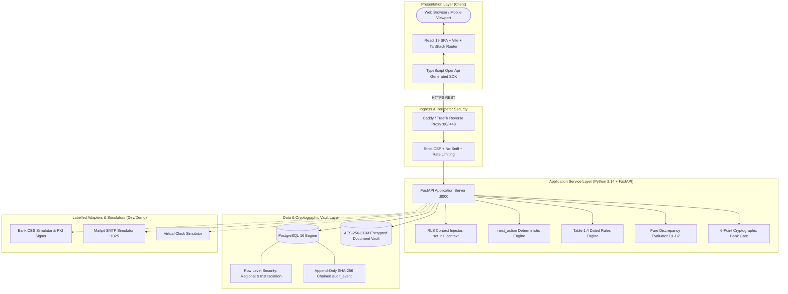
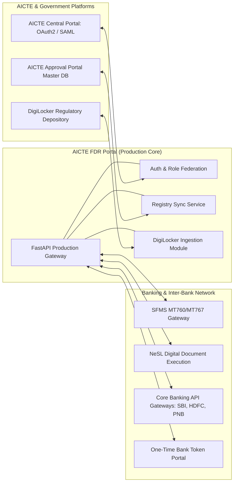

# AICTE Fixed Deposit Receipt (FDR) & Security Deposit Portal

[](https://github.com/Sidd2721/AICTE-/actions/workflows/ci.yml)
[](https://www.python.org/downloads/)
[](https://www.postgresql.org/)
[](https://react.dev/)
[](LICENSE)

High-assurance regulatory portal prototype engineered for **AICTE Problem Statement PS 26265** (*Monitoring and Verification of Fixed Deposit Receipts / Security Deposits*).

Automates institutional security deposit obligations, independent cryptographic bank confirmations, 10-year maturity and renewal monitoring, and strict dual-custody release authorization.

---

## 1. Executive Summary & Regulatory Mandate

Technical institutions seeking AICTE approval to establish campuses or add technical programmes must submit a mandatory security deposit as a Fixed Deposit Receipt (FDR) pledged jointly to AICTE for a statutory 10-year duration.

### The Regulatory Challenge
Under the legacy physical procedure:
1. **Paper Verification Fraud:** Regulators were vulnerable to forged bank letterheads, counterfeit stamps, and premature liquidations by institutions without AICTE consent.
2. **10-Year Horizon Lapses:** With thousands of institutions nationwide, tracking 10-year maturities and renewal cycles across disparate regional files resulted in unmonitored lapses.
3. **Single-Desk Release Vulnerability:** Lack of automated dual-custody controls created insider-threat exposure to unauthorized single-officer releases.
4. **Opaque Rule Computation:** Approval Process Handbook (APH) Table 1.4 formulas vary across programme levels, minority statuses, and land ownership types.

### The Solution: AICTE FDR Portal
A high-assurance system engineered under the foundational principle:
> **"Every fact is claimed or independently confirmed, with method, date, and expiry; the system proves it cryptographically; maker is never checker; and no regulatory numbers are hardcoded."**

---

## 2. The Two-Key Locker Analogy (Conceptual Overview)

Imagine an AICTE security deposit as a high-security bank vault deposit locker:

```
[ Technical Institution ]          [ Core Banking System (CBS) ]
         │                                       │
         ▼                                       ▼
  Submits FDR Claim                     Cryptographic Confirmation
  (Status: CLAIMED)                     (Status: CONFIRMED)
         │                                       │
         └───────────────────┬───────────────────┘
                             ▼
             [ AICTE Regulatory Portal Engine ]
              ├── 6-Point Cryptographic Bank Gate
              ├── Table 1.4 Dynamic Rules Engine
              ├── 10-Year Scheduled Obligation Worker
              └── SHA-256 Chained Append-Only Ledger
                             │
            ┌────────────────┴────────────────┐
            ▼                                 ▼
   [ Key 1: Regional Officer ]      [ Key 2: Bureau Head ]
         (MAKER STEP)                     (CHECKER STEP)
    Scrutinizes & Verifies            Authorizes Release & Issues
   (Blocked from Approving)            Offline Signed Receipt
```

- **Key 1 (Bank Confirmation):** The institution cannot self-certify its deposit. The bank's core system must independently confirm the principal amount, tenure, and exclusive joint lien.
- **Key 2 (Dual-Control Release):** When the 10-year lock-in concludes, **no single officer possesses release authority**. The Regional Officer verifies regulatory compliance (Maker), but the system strictly blocks them from approving it. A senior Bureau Head (Checker) must independently turn the second key.
- **The Inspection Camera (Tamper-Evident Ledger):** Every action is recorded into a cryptographic ledger where each event is SHA-256 hash-chained to the previous event. Out-of-band database modifications break the mathematical chain.

---

## 3. High-Level System Architecture



### Architectural Highlights
- **Python 3.14 Standard:** Built natively on Python 3.14 utilizing modern syntax (`except A, B:`).
- **Fail-Closed Database Security:** Runtime connections connect under `NOSUPERUSER` and `NOBYPASSRLS`. Every query executes within `set_rls_context(role, institution_id, user_id)`. Missing context returns zero rows.
- **Server-Driven User Interface:** Primary call-to-action buttons derive entirely from `next_action()`. No state-machine logic resides in frontend client code.
- **Integer Paise Accounting:** All financial balances are stored strictly as integer paise (`bigint`). Zero floating-point rounding errors.

---

## 4. The 15 Non-Negotiable System Safety Invariants (I1–I15)

The platform is governed by 15 safety invariants verified by automated mutation tests:

| Invariant | Requirement | Enforcement Mechanism |
| :--- | :--- | :--- |
| **I1: Computed Trust Badge** | Badges (`claimed`, `confirmed`, `stale`, `changed`) are computed dynamically in memory. | Never stored as an editable database column. |
| **I2: Degradation Resilience** | Bank service unreachable produces `"source unavailable"`, never `"mismatch"`. | Graceful degradation boundary handling. |
| **I3: Strict 6-Point Bank Gate** | Bank confirmation accepted only via the full byte-level gate. | Exact letter prefix, 1 valid signature, pinned certificate, non-repudiation. |
| **I4: Least-Privilege DB Access** | Application connects as `NOSUPERUSER` and `NOBYPASSRLS`. | Unauthenticated queries return zero tenant rows (fail-closed). |
| **I5: Append-Only Audit Chain** | State mutations write to `audit_event` via `audit_append()`. | Database triggers block `UPDATE`, `DELETE`, and `TRUNCATE`. |
| **I6: Integer Money in Paise** | All financial values stored as integer paise (`bigint`). | Floats strictly prohibited; stored in UTC, displayed in IST. |
| **I7: Dated Rulebook** | Regulatory rules are version-controlled, dated JSON files. | Startup halts outside development if rules contain unconfirmed DEMO values. |
| **I8: Maker-Checker Dual-Custody** | Verifier cannot approve releases (`verified_by <> approved_by`). | PostgreSQL table CHECK constraint + service API layer. |
| **I9: Privacy & Zero Leakage** | No real secrets, FDR numbers, PII, or unredacted tax IDs in git. | `.env` untracked; automated secrets scanners in CI. |
| **I10: Uniform Route Isolation** | Every route enforces authentication, RLS context, and audit logging. | Cross-scope operations return 403 Forbidden. |
| **I11: Invite-Only Access** | No public sign-up. 60-minute JWT token lifetime. | Sliding-window rate limiting on login and verification routes. |
| **I12: Regulatory Grounding** | Deposit amounts originate strictly from Approval Process Handbook tables. | Zero hardcoded financial constants in application code. |
| **I13: DSC Verification Boundary** | A Digital Signature Certificate proves submitter identity, not bank confirmation. | Separate document cryptographic inspection layers. |
| **I14: UI Determinism** | Primary buttons derive completely from `next_action()`. | Server-side deterministic workflow state machine. |
| **I15: Isolated Simulators** | Simulators exist only under `/sim` in development/demo mode. | Prominently watermarked with `[SIMULATED]`; disabled in production. |

---

## 5. Comprehensive Feature Breakdown

### A. Dynamic Approval Process Handbook Rules Engine (Table 1.4)
- **Dynamic Rule Ingestion:** Loaded from version-controlled files (`backend/app/rules/deposit.2024-04-01.json`).
- **Statutory Formula:**
  $$\text{Required Deposit} = \sum (\text{Base Rate for Programme Level}) \times (\text{Lease Multiplier}) \times (\text{Exemption Factor})$$
- Evaluates Engineering, Management, Planning, Architecture, and Computer Applications.
- Applies 2x multiplier for private leased infrastructure; automatically applies full exemption for accredited government institutions.
- **Coverage Card:** Real-time visual comparison showing Required vs. Confirmed deposit coverage.

### B. AES-256-GCM Encrypted Document Vault
- **Magic-Byte Inspection:** Verifies `%PDF`, `\x89PNG`, and `\xFF\xD8\xFF` headers prior to ingestion. Executable payloads or disguised scripts are rejected.
- **Authenticated Encryption at Rest:** Unique Initialization Vector (IV) per document.
- **Cryptographic Record Binding:** The unique `instrument_id` is passed as Additional Authenticated Data (AAD). If ciphertext is copied to another record, decryption fails cryptographically.

### C. The 6-Point Cryptographic Bank Gate
Bank confirmation letters must satisfy all 6 checkpoints:
1. **Issued Letter Prefix Match:** Reply begins with the exact bytes of the verification letter issued by AICTE (`reply.startswith(issued)`).
2. **Single Signature Count:** Exactly one valid PKCS#7 / CMS digital signature present.
3. **Cryptographic Integrity:** Document digest matches signature mathematically with zero modifications.
4. **Entire-File Byte Coverage:** Signature covers the complete byte stream (`SignatureCoverageLevel.ENTIRE_FILE`), rejecting trailing page insertions.
5. **Pinned Certificate Trust:** Signer certificate fingerprint matches the bank's registered public root.
6. **Non-Repudiation Key Usage:** Enforces explicit `nonRepudiation` X.509 extensions.

### D. Automated Discrepancy Engine (D1–D7)
Pure functional evaluation checking bank assertions against institutional claims:
- **D1 (Amount Shortfall):** Bank confirmed amount is less than claimed deposit. (Severity: BLOCK).
- **D2 (Maturity Discrepancy):** Bank maturity date is shorter than statutory term. (Severity: BLOCK).
- **D3 (Cross-Institution Duplicate):** Same bank code and FDR reference registered to another entity. (Severity: BLOCK).
- **D4 (Bank IFSC Mismatch):** Bank code fails RBI IFSC prefix pattern. (Severity: BLOCK).
- **D5 (Lien Discrepancy):** FDR is not marked with an exclusive joint lien to AICTE. (Severity: BLOCK).
- **D6 (Missing Statutory Documents):** Required Affidavits (Affidavit 3, 4, 6, 9) missing. (Severity: BLOCK).
- **D7 (Renewal Coverage Gap):** Replacement FDR issue date is later than predecessor maturity date. (Severity: WARN).
- **Mandatory Scrutiny Justification:** Manual discrepancy waivers require an officer justification note ($\ge 10$ characters) immutably recorded in the audit trail.

### E. Virtual Clock & Daily Scheduled Worker
- **Advisory Lock Concurrency:** Operates safely in multi-instance environments using PostgreSQL advisory lock `847291`.
- **Idempotency Guarantee:** Enforced by relational uniqueness constraints `UNIQUE(obligation_id, step)`.
- **Scheduled Escalation Matrix:** Automatically dispatches T-90, T-60, and T-30 renewal reminders to institutions and escalates overdue records to Regional Officers.

### F. Dual-Custody Release Governance
- **Segregation of Duties:** Regional Officer verifies checklist (Maker). Bureau Head authorizes release (Checker).
- **Database Enforcement:** `CONSTRAINT chk_release_request_maker_checker CHECK (verified_by <> approved_by)`.
- **Offline Cryptographic Receipt:** Once authorized, the system issues an RS256/JWT release receipt containing the instrument digest and timestamp, verifiable offline with AICTE's public key (`scripts/verify_receipt.py`).

### G. Tamper-Evident SHA-256 Audit Ledger
- **Cryptographic Chaining:**
  $$\text{entry\_hash}_n = \text{SHA-256}(\text{prev\_hash}_{n-1} \,||\, \text{timestamp} \,||\, \text{actor\_id} \,||\, \text{event\_type} \,||\, \text{payload})$$
- Database triggers permanently block `UPDATE`, `DELETE`, and `TRUNCATE` operations.
- `SELECT audit_verify()` validates ledger continuity in real-time.

---

## 6. Seed Matrix & Contracted Personas

The portal is seeded with a dual-region, dual-custody maker-checker matrix:

| Role | Contracted Email | Region | Responsibilities | Default Password |
| :--- | :--- | :--- | :--- | :--- |
| **Institution** | `inst.north1@example.com` | North (NR) | Submits FDR details, views Table 1.4 coverage card, requests releases. | `changethis` |
| **Regional Officer (Maker)** | `officer.north@example.com` | North (NR) | Scrutinizes submissions, verifies releases (strictly blocked from approving). | `changethis` |
| **Regional Checker** | `checker.north@example.com` | North (NR) | Verifies regional officer recommendations (maker-checker separation). | `changethis` |
| **Bureau Approver (Checker)** | `bureau@example.com` | National | Advances virtual clock, approves verified releases (Maker != Checker). | `changethis` |
| **External Auditor** | `auditor@example.com` | National | Read-only oversight across all regions; verifies SHA-256 audit ledger. | `changethis` |
| **System Admin** | `admin@example.com` | National | User provisioning and system rule inspection. | `changethis` |

---

## 7. Enterprise Integration Blueprint (Production Target)



- **AICTE Central Single Sign-On:** Integration via OAuth 2.0 / SAML 2.0 with existing government credentials.
- **Master Data Synchronization:** Automated REST / Kafka synchronization of Permanent Institute IDs (PID), approved programme levels, and seat intake.
- **Extension of Approval (EoA) Gatekeeping:** Internal webhook `GET /api/v1/institutions/{id}/coverage-status` allowing AICTE's central portal to automatically withhold annual EoA approvals if FDR coverage is deficient.
- **DigiLocker Depository:** Ingestion of bank-issued PDF-A certificates directly via W3C Verifiable Credentials.
- **Structured Financial Messaging System (SFMS):**
  * `MT760`: Electronic Fixed Deposit / Guarantee confirmation advice.
  * `MT767`: 10-year term renewal advice.
  * `MT769`: Electronic lien discharge advice upon Bureau approval.
- **NeSL Digital Document Execution (DDE):** Electronic lien marking and legally binding digital charge filing on bank deposit instruments.

---

## 8. Quick Start & Local Setup

### Prerequisites
- Python 3.14+
- uv package manager (`0.9.26+`)
- Bun runtime (`1.0+`)
- PostgreSQL 16

### One-Command Setup & Demo
```powershell
# 1. Reset database, seed synthetic data, and run 7-step showcase
powershell -ExecutionPolicy Bypass -File scripts/run-demo.ps1 -Reset

# 2. Access the portal
# Web UI: http://localhost:8000
# Interactive 6-minute tour: http://localhost:8000/guide
```

### Manual Development Setup
```bash
# 1. Configure environment
cp .env.example .env
uv run python scripts/gen_secrets.py

# 2. Setup backend dependencies and database migrations
cd backend
uv sync
uv run alembic upgrade head
uv run python app/initial_data.py

# 3. Build frontend assets
cd ../frontend
bun install
bun run build

# 4. Start backend server
cd ../backend
uv run uvicorn app.main:app --reload --port 8000
```

---

## 9. Quality Gate & Automated Verification

The project includes a 10-point quality gate:

```powershell
# Run the complete verification gate (Windows PowerShell)
powershell -ExecutionPolicy Bypass -File scripts/verify.ps1

# Run full gate on Linux / Git Bash
bash scripts/verify.sh
```

### Verification Checks Executed
1. **Backend Tests:** 172 unit and integration tests passing (`uv run pytest -q`).
2. **Type Checking:** Strict Mypy validation (`uv run mypy app`).
3. **Python Linting:** Ruff lint and formatting checks (`uv run ruff check app`).
4. **Frontend Linting:** Biome code quality checks (`bunx biome check`).
5. **Frontend Compilation:** Full production asset compilation (`bun run build`).
6. **Leak Prevention:** Scan compiled distribution bundle for default passwords.
7. **Capability Map:** Verify all 10 problem statement capabilities across 29 mapped tests.
8. **Client Drift:** Verify OpenAPI generated TypeScript client matches FastAPI routes.
9. **Documentation Drift:** Verify `DEMO.md` is synchronized with `docs/guide.json`.
10. **Claims & Reference Lint:** Verify honest claims and script path integrity.

---

## 10. Free-Tier Cloud Deployment (Render + Neon)

The repository is configured for zero-cost cloud deployment using Render (Docker Web Service) and Neon (PostgreSQL 16):

1. **Database Setup (Neon):**
   * Create a PostgreSQL 16 project on [neon.tech](https://neon.tech).
   * Copy the direct connection string for the database owner (`neondb_owner`).
   * Run [scripts/db-roles-managed.sql](scripts/db-roles-managed.sql) via `psql` to create the restricted `app` role (`NOSUPERUSER NOBYPASSRLS`).
2. **Service Deployment (Render):**
   * Connect your GitHub repository using **Render Blueprint** ([render.yaml](render.yaml)).
   * Supply the generated environment variables from `scripts/gen_secrets.py`.
   * Set `DATABASE_URL` to the direct Neon string with username `app`.
   * Set `MIGRATION_DATABASE_URL` to the owner string with username `neondb_owner`.
3. **Live Verification:**
   ```bash
   uv run python scripts/smoke_deployed.py https://<your-service>.onrender.com
   ```

For detailed deployment guidance, refer to [DEPLOY-GUIDE.md](DEPLOY-GUIDE.md) and [REVIEW.md](REVIEW.md).

---

## 11. Honest Prototype Limits & Non-Claims

- **DEMO Rule Values:** Table 1.4 Approval Process Handbook rules are marked `DEMO` pending official council gazette confirmation; startup is blocked outside development/demo.
- **SIMULATED Bank & Email:** Bank confirmation APIs and email notices are SIMULATED and transparently labelled.
- **Synthetic Data Only:** All institutions, deposit amounts, reference numbers, and metrics are synthetic.
- **No Direct Banking Network:** Does not connect to live SFMS, RTGS, or RBI Core Banking Systems without regulatory MOUs.
- **Dual-Control Release:** The system provides automated recommendations; release authorization requires human approval.

---

## 12. Documentation Index

- [DEMO.md](DEMO.md) — 7-step live evaluation script synchronized with `docs/guide.json`.
- [DEPLOY-GUIDE.md](DEPLOY-GUIDE.md) — Production deployment instructions for Render and Neon.
- [REVIEW.md](REVIEW.md) — Architectural assessment, security findings, and resolution records.
- [docs/PRESENT.md](docs/PRESENT.md) — 30-second elevator pitch, 2-minute locker analogy, and evaluator Q&A sheet.
- [docs/EVIDENCE.md](docs/EVIDENCE.md) — Verifiable evidence map and mutation testing records.
- [docs/TIMING.md](docs/TIMING.md) — Baseline vs. portal operational timing comparisons.
- [docs/DECISIONS.md](docs/DECISIONS.md) — Architecture decision records (ADRs).
