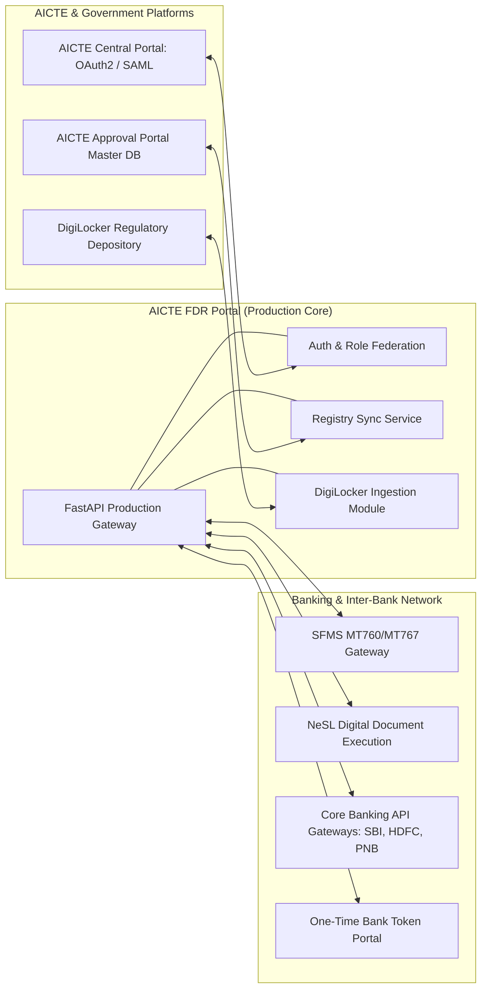

# AICTE Security Deposit / Fixed Deposit Receipt (FDR) Portal

[](https://github.com/Sidd2721/AICTE-/actions/workflows/ci.yml)
[](https://www.python.org/downloads/)
[](https://www.postgresql.org/)
[](https://react.dev/)
[](LICENSE)

defense-in-depth regulatory portal prototype engineered for **AICTE Problem Statement PS 26265** (*Monitoring and Verification of Fixed Deposit Receipts / Security Deposits*).

Automates institutional security deposit obligations, independent cryptographic bank confirmations, 10-year maturity and renewal monitoring, and strict dual-custody release authorization.

---

## ⚡ Verify in 60 Seconds (Live Evaluator Guide)

**Live Deployment URL:** [https://aicte-1-59pn.onrender.com](https://aicte-1-59pn.onrender.com)  
*(Hosted 24/7 on Render Docker Web Service + Neon PostgreSQL with Row-Level Security)*

### The 5 Demo Personas (1-Click Switcher Available on Sign-In Page)

| Persona | Role & Mandate | Email | Password |
| :--- | :--- | :--- | :--- |
| **Technical Institution** | Submits FDR deposits, views deficit/surplus coverage | `inst.north1@example.com` | `AdminSecure2026!` |
| **Regional Officer** | Scrutiny Maker: reviews documents, initiates release | `officer.north@example.com` | `AdminSecure2026!` |
| **Scrutiny Checker** | Checker: reviews flagged discrepancies and audits | `checker.north@example.com` | `AdminSecure2026!` |
| **Bureau Head** | Approver: authorizes releases, turns second key | `bureau@example.com` | `AdminSecure2026!` |
| **Regulatory Auditor** | Read-only inspection of hash-chain & system logs | `auditor@example.com` | `AdminSecure2026!` |

---

### 7 Read-Only Verification Steps (Zero Data Entry, Pure Proof)

1. **Dashboard Overview:** Log in as any persona (or use 1-click login) -> inspect the live dashboard metrics, active deposit lifecycle distribution, and deficit/surplus coverage.
2. **Statement Reports (4 Tabs):** Navigate to **Reports** -> inspect all 4 regulatory tabs:
   - *Pending Verifications* (FDRs awaiting bank confirmation)
   - *Upcoming Maturities* (FDRs expiring within 90 days)
   - *Missing Documents* (Cases missing mandatory attachments)
   - *Cases Needing Intervention* (Discrepancies, failed gates, or expired tenures)
3. **Statement PDF Export:** Click **Export PDF** on the Reports page -> downloads a server-side ReportLab PDF with Indian currency formatting (`Rs.`), DEMO watermark, and timestamp.
4. **Audit Hash-Chain Verification:** Navigate to **Audit** -> click **Verify Audit Hash-Chain** -> verifies cryptographic SHA-256 hash-chain integrity with status `clean`.
5. **Download Demo Release Receipt PDF:** Download the signed sample release receipt directly:  
   [`https://aicte-1-59pn.onrender.com/api/v1/demo/sample-receipt.pdf`](https://aicte-1-59pn.onrender.com/api/v1/demo/sample-receipt.pdf)  
   Observe the DEMO watermark, QR code, verified claims box, and RS256 token block.
6. **Public Cryptographic Verification:** Open the unauthenticated public verifier:  
   [`https://aicte-1-59pn.onrender.com/verify-receipt`](https://aicte-1-59pn.onrender.com/verify-receipt)  
   Click **Load Sample Token** (or paste token from PDF) -> click **Verify Signature** -> displays green **VALID** badge with decoded claims (`receipt_id`, `instrument_hash`, `path`, `issued_at`, `kid`).
7. **Tamper Rejection Proof:** Click **Tamper 1 Character** (or flip any character in the signature) -> click **Verify Signature** -> displays red **INVALID** badge with cryptographic failure reason.

---

## Quick Navigation

- [1. Executive Summary & Regulatory Mandate](#1-executive-summary--regulatory-mandate)
- [2. The Two-Key Locker Analogy (Conceptual Overview)](#2-the-two-key-locker-analogy-conceptual-overview)
- [3. Interactive Walkthrough Video & Player Guide](#3-interactive-walkthrough-video--player-guide)
- [4. High-Level System Architecture & Layer Breakdown](#4-high-level-system-architecture--layer-breakdown)
- [5. Why This Solution Is Unique: Research & Architectural Differentiators](#5-why-this-solution-is-unique-research--architectural-differentiators)
- [6. The 15 Non-Negotiable System Safety Invariants (I1–I15)](#6-the-15-non-negotiable-system-safety-invariants-i1i15)
- [7. Comprehensive Feature Breakdown (The 10 Statement Capabilities)](#7-comprehensive-feature-breakdown-the-10-statement-capabilities)
- [8. The 7 Core Demonstration Scenarios (Live Evaluation Script)](#8-the-7-core-demonstration-scenarios-live-evaluation-script)
- [9. Contracted Personas & Credentials Matrix](#9-contracted-personas--credentials-matrix)
- [10. Complete Master Presentation Pitch Deck (10-Slide PPT Blueprint)](#10-complete-master-presentation-pitch-deck-10-slide-ppt-blueprint)
- [11. Enterprise Integration Blueprint (Production Architecture)](#11-enterprise-integration-blueprint-production-architecture)
- [12. How to Run & Deploy (Local, Docker & Free Cloud)](#12-how-to-run--deploy-local-docker--free-cloud)
- [13. Verification & Quality Gate (All Proving Commands)](#13-verification--quality-gate-all-proving-commands)
- [14. Evaluator Q&A Defense & Skepticism Cheat Sheet](#14-evaluator-qa-defense--skepticism-cheat-sheet)
- [15. Honest Prototype Limits & Non-Claims](#15-honest-prototype-limits--non-claims)

---

## 1. Executive Summary & Regulatory Mandate

Technical institutions seeking AICTE approval to establish campuses or add technical programmes must submit a mandatory security deposit as a Fixed Deposit Receipt (FDR) pledged jointly to AICTE for a regulatory 10-year duration.

### The Regulatory Challenge
Under the legacy physical procedure:
1. **Paper Verification Fraud:** Regulators were vulnerable to forged bank letterheads, counterfeit stamps, and premature liquidations by institutions without AICTE consent.
2. **10-Year Horizon Lapses:** With thousands of institutions nationwide, tracking 10-year maturities and renewal cycles across disparate regional files resulted in unmonitored lapses.
3. **Single-Desk Release Vulnerability:** Lack of automated dual-custody controls created insider-threat exposure to unauthorized single-officer releases.
4. **Opaque Rule Computation:** Approval Process Handbook (APH) Table 1.4 formulas vary across programme levels, minority statuses, and land ownership types.

### The Solution: AICTE FDR Portal
A defense-in-depth system engineered under the foundational principle:
> **"Every fact is claimed or independently confirmed, with method, date, and expiry; the system proves it cryptographically; maker is never checker; and no regulatory numbers are hardcoded."**

---

## 2. The Two-Key Locker Analogy (Conceptual Overview)

Imagine an AICTE security deposit as a high-security bank vault deposit locker:

```
[ Technical Institution ]          [ Core Banking System (CBS) ]
         │                                       │
         ▼                                       ▼
  Submits FDR Claim                     Cryptographic Confirmation
  (Status: CLAIMED)                     (Status: CONFIRMED)
         │                                       │
         └───────────────────┬───────────────────┘
                             ▼
             [ AICTE Regulatory Portal Engine ]
              ├── 6-Point Cryptographic Bank Gate
              ├── Table 1.4 Dynamic Rules Engine
              ├── 10-Year Scheduled Obligation Worker
              └── SHA-256 Chained Append-Only Ledger
                             │
            ┌────────────────┴────────────────┐
            ▼                                 ▼
   [ Key 1: Regional Officer ]      [ Key 2: Bureau Head ]
         (MAKER STEP)                     (CHECKER STEP)
    Scrutinizes & Verifies            Authorizes Release & Issues
   (Blocked from Approving)            Offline Signed Receipt
```

- **Key 1 (Bank Confirmation):** The institution cannot self-certify its deposit. The bank's core system must independently confirm the principal amount, tenure, and exclusive joint lien.
- **Key 2 (Dual-Control Release):** When the 10-year lock-in concludes, **no single officer possesses release authority**. The Regional Officer verifies regulatory compliance (Maker), but the system strictly blocks them from approving it. A senior Bureau Head (Checker) must independently turn the second key.
- **The Inspection Camera (Tamper-Evident Ledger):** Every action is recorded into a cryptographic ledger where each event is SHA-256 hash-chained to the previous event. Out-of-band database modifications break the mathematical chain.

---

## 3. Interactive Walkthrough Video & Player Guide

The repository includes complete recorded walkthrough demonstrations and dedicated offline HTML5 visual players:

### Video 1 — End-to-End Operational Walkthrough (7-Step Demo)
- **Recorded Walkthrough Video:** Located at [`docs/demo_video.mp4`](docs/demo_video.mp4) (H.264 MP4, ~2.1 MB).
- **Interactive Player with HUD Callouts:** Open [`docs/video_player.html`](docs/video_player.html) in any standard web browser.
- **Video Generator Script:** Re-recordable on demand via [`scripts/record_full_demo_video.js`](scripts/record_full_demo_video.js) using Playwright.

### Video 2 — Complete Technical Architecture Deep Dive (4m 50s Motion Graphics & 90s Judge Cut)
- **Interactive Motion Graphics Stage (1080p 60fps):** Open [`docs/video2_architecture_motion_graphics.html`](docs/video2_architecture_motion_graphics.html) in any browser (interactive scrubber, voice synthesis narrator toggle, live packet flow animation).
- **Recorded Video (90s Judge Cut):** [`docs/media/architecture_video_90s_1080p.mp4`](docs/media/architecture_video_90s_1080p.mp4) (1080p H.264, 2.92 MB, SHA-256: `8f5463f3c4ad18dbdba331452ee80da9b6571e5f2088c0de3289312ddf4a701c`).
- **Synchronized Closed Captions:** [`docs/media/architecture_video.vtt`](docs/media/architecture_video.vtt).
- **Architectural Storyboard & Script Walkthrough:** [`docs/VIDEO2_ARCHITECTURE_WALKTHROUGH.md`](docs/VIDEO2_ARCHITECTURE_WALKTHROUGH.md).
- **Automated Recording Script:** Re-recordable on demand via `node scripts/record_architecture_video.js [preview|full]`.

### Video Scene Breakdown
1. **Scene 1 (0:00–0:10 / 0:00-0:20 in Video 2):** System Architecture Overview & Table 1.4 Coverage Calculator.
2. **Scene 2 (0:10–0:20 / 0:20-01:10 in Video 2):** API Architecture, Idempotency & 6-Point Cryptographic Bank Gate.
3. **Scene 3 (0:20–0:30 / 01:10-01:55 in Video 2):** Database Architecture, PostgreSQL RLS & Integer-Paise Arithmetic.
4. **Scene 4 (0:30–0:40 / 01:55-02:35 in Video 2):** Technology Stack Matrix & Core Banking / AICTE Simulators.
5. **Scene 5 (0:40–0:50 / 02:35-03:40 in Video 2):** 8-Stage Deposit Lifecycle Circuit & T-90/60/30 Maturity Alerts.
6. **Scene 6 (0:50–1:00 / 03:40-04:20 in Video 2):** Caddy Edge Routing & Multi-Role User Interface Flow.
7. **Scene 7 (1:00–1:15 / 04:20-04:50 in Video 2):** Architecture Summary, 4 Core Pillars & Verification Scoreboard.

---

## 4. High-Level System Architecture & Layer Breakdown


### Architectural Layer Explanations

1. **Presentation Layer (React 19 SPA):**
   - Built with React 19, TypeScript, TanStack Router, and TanStack Query.
   - **Zero Client Logic:** Primary call-to-action buttons derive entirely from `next_action()`. The frontend never computes business logic or decision transitions.
   - **Offline Self-Contained:** Zero external CDNs, Google Fonts, or tracking scripts. Fully functional in offline, air-gapped regulatory networks.
2. **Security Gateway Layer (Caddy / Traefik):**
   - Edge reverse proxy enforcing automated TLS, HSTS, frame-ancestors restrictions, nosniff, and strict Content Security Policies (CSP).
3. **Application Core Layer (FastAPI + Python 3.14):**
   - Built natively on Python 3.14 with modern multi-exception syntax (`except A, B:`).
   - Injects tenant session context on every request via `set_rls_context(role, institution_id, user_id)`.
   - Pure functional domain logic in `app/domain/` for bank confirmation parsing, rules evaluation, discrepancy checks, and receipt generation.
4. **Data & Storage Kernel (PostgreSQL 16 + AES-GCM Vault):**
   - **Dual Role Access:** Database owner (`migrator`) manages schema DDL; runtime application (`app`) has `NOSUPERUSER` and `NOBYPASSRLS`.
   - **Row-Level Security:** Missing or malformed session context returns zero rows (fail-closed).
   - **Encrypted Document Vault:** AES-256-GCM authenticated cipher with unique per-file IV and `instrument_id` AAD binding.
   - **Immutable Audit Ledger:** Append-only table guarded by database triggers that reject `UPDATE`, `DELETE`, and `TRUNCATE`.
5. **Background Scheduled Worker (`app/jobs/daily.py`):**
   - Executes daily scans protected by PostgreSQL advisory lock `847291`.
   - Uniqueness constraints `UNIQUE(obligation_id, step)` ensure idempotent reminder generation.

---

## 5. Why This Solution Is Unique: Research & Architectural Differentiators

For an exhaustive research synthesis and enterprise rollout blueprint, refer to [docs/UNIQUE_RESEARCH_AND_ENTERPRISE_ARCHITECTURE.md](docs/UNIQUE_RESEARCH_AND_ENTERPRISE_ARCHITECTURE.md).

Most regulatory portals treat deposit tracking as a basic CRUD web application with file uploads. Our domain research across the AICTE Approval Process Handbook (2024–27), SFMS standards, and NeSL legal frameworks established that **security deposit monitoring is fundamentally a cryptographic trust and dual-custody governance problem**.

| Capability Dimension | Standard Industry / Hackathon Approach | AICTE FDR Portal (Our Approach) | Why Our Approach Is Superior |
| :--- | :--- | :--- | :--- |
| **Trust Model** | Self-reported claims stored directly as "verified". | Dynamic 4-state trust engine: `claimed` -> `confirmed` -> `stale` -> `changed`. | Badges computed dynamically in memory; an institution's claim is never confused with independent bank proof (I1). |
| **Bank Verification** | Manual paper letters or simple PDF viewer checks. | **6-Point Cryptographic Gate** evaluating raw PDF bytes via PKCS#7 validation. | Rejects forged bank seals, modified amounts, untrusted signers, and trailing appended pages (`SignatureCoverageLevel.ENTIRE_FILE`) (I3). |
| **Governance & Authorization** | Any logged-in officer can click "Approve Release". | **Strict Maker-Checker Dual-Custody** enforced by PostgreSQL table `CHECK` constraints and service logic. | Regional Officer who verifies is physically blocked from approving (`verified_by <> approved_by`) (I8). |
| **Audit & Anti-Tampering** | Standard database logs that can be updated or dropped. | **Append-Only SHA-256 Chained Ledger** where every row contains `SHA256(prev_hash + payload)`. | Database triggers permanently block `UPDATE`, `DELETE`, and `TRUNCATE`. Real-time verification via `SELECT audit_verify()` detects any disk tampering (I5). |
| **Financial Accounting** | Standard IEEE 754 floating-point decimals (`float`). | **Integer Paise Accounting (`bigint`)** throughout entire stack. | 1 Lakh = 10,000,000 paise. Eliminates binary floating-point cumulative rounding errors across thousands of deposits (I6). |
| **Regulatory Rulebook** | Hardcoded monetary constants embedded directly in code. | **Dated, Version-Controlled JSON Rulebook** loaded dynamically per academic year. | Regulatory updates in the AICTE Gazette are applied by dropping in a new dated JSON file without modifying backend code (I7, I12). |
| **Document Vault Security** | Unencrypted files stored in public web folders. | **AES-256-GCM Authenticated Vault** with magic-byte checks and unique record AAD binding. | Pre-upload magic-byte inspection blocks executable exploits; unique `instrument_id` AAD prevents cross-record payload theft (I9). |
| **User Interface Logic** | Client-side JavaScript state machines determining button visibility. | **Server-Driven Next-Action Determinism (`next_action()`)**. | Zero business state logic leaks into frontend. The server evaluates lifecycle, badge, and discrepancies to render the single primary action button (I14). |

---

## 6. The 15 Non-Negotiable System Safety Invariants (I1–I15)

The entire platform is governed by 15 architectural invariants verified by automated mutation tests:

| Invariant | Requirement | Enforcing Code Reference | Verification Proof |
| :--- | :--- | :--- | :--- |
| **I1: Computed Trust Badge** | Badges (`claimed`, `confirmed`, `stale`, `changed`) are computed dynamically in memory. | `backend/app/domain/trust.py:34` | Never stored as an editable database column. |
| **I2: Degradation Resilience** | Bank service unreachable produces `"source unavailable"`, never `"mismatch"`. | `backend/app/api/routes/bank.py:270` | Tested in `test_bank_simulator_and_discrepancy.py`. |
| **I3: Strict 6-Point Bank Gate** | Bank confirmation accepted only via the full byte-level gate. | `backend/app/domain/bank_gate.py:22` | Tested against forged signatures & appended bytes. |
| **I4: Least-Privilege DB Access** | Application connects as `NOSUPERUSER` and `NOBYPASSRLS`. | `backend/app/core/rls_context.py:31` | Tested in `test_sql_behaviour.py` (fail-closed). |
| **I5: Append-Only Audit Chain** | State mutations write to `audit_event` via `audit_append()`. | `backend/app/core/audit.py:40` | Database triggers block `UPDATE`, `DELETE`, `TRUNCATE`. |
| **I6: Integer Money in Paise** | All financial values stored as integer paise (`bigint`). | `backend/app/models.py:75` | Floats strictly prohibited; stored in UTC, shown in IST. |
| **I7: Dated Rulebook** | Regulatory rules are version-controlled, dated JSON files. | `backend/app/domain/rules.py:72` | Startup halts outside development if rules are DEMO. |
| **I8: Maker-Checker Dual-Custody** | Verifier cannot approve releases (`verified_by <> approved_by`). | `backend/app/api/routes/release.py:245` | Enforced by table CHECK constraint + service API layer. |
| **I9: Privacy & Zero Leakage** | No real secrets, FDR numbers, PII, or unredacted tax IDs in git. | `.gitignore` & CI scanners | Verified by CI secret-scan workflow. |
| **I10: Uniform Route Isolation** | Every route enforces authentication, RLS context, and audit logging. | `backend/app/api/deps.py:47` | Cross-scope operations return 403 Forbidden. |
| **I11: Invite-Only Access** | No public sign-up. 60-minute JWT token lifetime. | `backend/app/api/routes/login.py:65` | Sliding-window rate limiting on login routes. |
| **I12: Regulatory Grounding** | Deposit amounts originate strictly from Approval Process Handbook tables. | `backend/app/rules/deposit.2024-04-01.json` | Zero hardcoded financial constants in application code. |
| **I13: DSC Verification Boundary** | A Digital Signature Certificate proves submitter identity, not bank confirmation. | `backend/app/domain/bank_gate.py:44` | Separate document cryptographic inspection layers. |
| **I14: UI Determinism** | Primary buttons derive completely from `next_action()`. | `backend/app/domain/next_action.py:38` | Server-side deterministic workflow state machine. |
| **I15: Isolated Simulators** | Simulators exist only under `/sim` in development/demo mode. | `backend/app/api/main.py:35` | Prominently watermarked with `[SIMULATED]`. |

---

## 7. Comprehensive Feature Breakdown (The 10 Statement Capabilities)

### 1. Dynamic Approval Process Handbook Rules Engine (Table 1.4)
- **Problem Solved:** Handbook formulas evolve across academic editions. Hardcoded numbers break upon Gazette amendments.
- **Implementation:** Stored in dated version-controlled JSON files (`backend/app/rules/deposit.2024-04-01.json`).
- **Dynamic Formula:**
  $$\text{Required Deposit} = \sum (\text{Base Rate for Programme Level}) \times (\text{Lease Multiplier}) \times (\text{Exemption Factor})$$
- Evaluates technical programmes (Engineering, Management, Planning, Architecture, Computer Applications).
- Multipliers & Exemptions: 2x multiplier automatically applied for private leased properties; automatically applies full exemption for accredited government institutions.
- **Integer Paise Representation:** Handled strictly in integer paise ($1\text{ Lakh} = 10^7\text{ paise}$).

### 2. Encrypted Document Vault (`app/domain/vault.py`)
- **Pre-Ingestion Inspection:** Validates magic bytes (`%PDF`, `\x89PNG`, `\xFF\xD8\xFF`). Disguised executables and malicious scripts are rejected.
- **Authenticated Encryption at Rest:** Encrypted with AES-256-GCM using a unique Initialization Vector (IV) per file.
- **Cryptographic Binding (AAD):** Unique database `instrument_id` is passed as Additional Authenticated Data. Decryption under any other record fails cryptographically.

### 3. The 6-Point Cryptographic Bank Gate (`app/domain/bank_gate.py`)
Incoming digital bank confirmation letters pass through 6 checks:
1. **Issued Letter Prefix Match:** The counter-signed PDF must begin with the exact bytes of the verification letter issued by AICTE (`reply.startswith(issued)`).
2. **Single Signature Count:** Exactly one valid PKCS#7 / CMS digital signature present.
3. **Cryptographic Integrity:** Document digest matches signature mathematically with zero modifications.
4. **Entire-File Byte Coverage:** Signature covers the complete byte stream (`SignatureCoverageLevel.ENTIRE_FILE`), rejecting trailing page insertions.
5. **Pinned Certificate Trust:** Signer certificate fingerprint matches the bank's registered public root.
6. **Non-Repudiation Key Usage:** Enforces explicit `nonRepudiation` X.509 extensions.

### 4. Pure Discrepancy Engine (D1–D7) (`app/domain/discrepancy.py`)
Pure functional evaluation checking bank assertions against institutional claims:
- **D1 (Amount Shortfall):** Bank confirmed amount is less than claimed deposit. (Severity: BLOCK).
- **D2 (Maturity Discrepancy):** Bank maturity date is shorter than regulatory term. (Severity: BLOCK).
- **D3 (Cross-Institution Duplicate):** Same bank code and FDR reference registered to another entity. (Severity: BLOCK).
- **D4 (Bank IFSC Mismatch):** Bank code fails RBI IFSC prefix pattern. (Severity: BLOCK).
- **D5 (Lien Discrepancy):** FDR is not marked with an exclusive joint lien to AICTE. (Severity: BLOCK).
- **D6 (Missing regulatory Documents):** Required Affidavits (Affidavit 3, 4, 6, 9) missing. (Severity: BLOCK).
- **D7 (Renewal Coverage Gap):** Replacement FDR issue date is later than predecessor maturity date. (Severity: WARN).
- **Mandatory Scrutiny Justification:** Manual discrepancy waivers require an officer justification note ($\ge 10$ characters) immutably recorded in the audit trail.

### 5. Virtual Clock Time Machine & Daily Scheduled Worker
- **Advisory Lock Concurrency:** Operates safely in multi-instance environments using PostgreSQL advisory lock `847291`.
- **Idempotency Guarantee:** Enforced by relational uniqueness constraints `UNIQUE(obligation_id, step)`.
- **Scheduled Escalation Matrix:** Automatically dispatches T-90, T-60, and T-30 renewal reminders to institutions and escalates overdue records to Regional Officers.

### 6. Dual-Custody Release Governance (Maker-Checker)
- **Hard Rule I8:** Release authorization follows a strict two-person control model:
  * **Maker Step (Regional Officer):** Scrutinizes closure, merger, university conversion, or term completion documents and verifies release eligibility. The RO is physically and cryptographically blocked from approving the release.
  * **Checker Step (Bureau Approver):** National Bureau Approver reviews the verified case and authorizes release.
- **Relational Enforcement:** `CONSTRAINT chk_release_request_maker_checker CHECK (verified_by <> approved_by)`.
- **Service Enforcement:** Attempts by the verifier to approve return `403 Forbidden` (`MAKER_CANNOT_BE_CHECKER`).
- **Offline Cryptographic Encashment Receipt:** Once authorized, the system issues an RS256/JWT release receipt containing the instrument digest and timestamp, verifiable offline with AICTE's public key (`scripts/verify_receipt.py`).

### 7. Tamper-Evident SHA-256 Audit Ledger (`starter/sql/audit.sql`)
- **Structure:** Every mutation appends an entry:
  $$\text{entry\_hash} = \text{SHA-256}(\text{prev\_hash} \,||\, \text{timestamp} \,||\, \text{event\_type} \,||\, \text{user\_id} \,||\, \text{canonical\_payload})$$
- Database triggers permanently block `UPDATE`, `DELETE`, and `TRUNCATE` operations on `audit_event`.
- `SELECT audit_verify()` validates ledger continuity in real-time.

### 8. Deterministic Workflow Next-Action Engine
- Central state machine computing the single primary action button, owner role, and urgency deadline based on lifecycle state, badge status, and active discrepancy flags.

### 9. Formula Injection Defense (`app/domain/csv_safe.py`)
- Sanitizes formula trigger characters (`=`, `+`, `-`, `@`, `\t`, `\r`) from all CSV export records to protect regulatory spreadsheets against remote code execution.

### 10. Fraud Lab & Benchmark Engine (`app/domain/fraud_lab.py`)
- Evaluates synthetic test matrices (20 planted discrepancies, 20 clean records) to verify zero false passes and zero false rejections.

---

## 8. The 7 Core Demonstration Scenarios (Live Evaluation Script)

Synchronized with [`DEMO.md`](DEMO.md) and [`docs/guide.json`](docs/guide.json):

```
=======================================================================================================
STEP 1: Institution: Coverage Card -> Calculator -> Submit FDR
Actor: Institution User (`inst.north1@example.com`) | Route: /deposits
Actions:
  1. Sign in using 1-click persona switcher as Institution.
  2. Inspect Coverage Card showing Required vs Confirmed balance.
  3. Open Table 1.4 Calculator: Select Engineering (UG) + Management (PG) (Required: ₹ 50,00,000).
  4. Submit new FDR instrument with certificate scan.
Expected Outcome: Instrument created with badge 'Submitted (Claimed)'. Stored in AES-GCM vault.
Why this matters: Transparent rule derivation removes manual calculation ambiguity.
-------------------------------------------------------------------------------------------------------
STEP 2: RO Requests Bank Confirmation -> SIMULATED Reply -> 6-Point Gate
Actor: Regional Officer (`officer.north@example.com`) | Route: /deposits
Actions:
  1. Switch to Regional Officer persona.
  2. Open case page for submitted instrument.
  3. Click single primary action 'Request Bank Confirmation'.
  4. Inspect the 6-Point Cryptographic Bank Gate evaluation report.
Expected Outcome: All 6 checkpoints turn green. Status badge updates to 'Confirmed by Bank (SIMULATED)'.
Why this matters: No deposit is trusted on self-declarations alone. Independent bank proof is required.
-------------------------------------------------------------------------------------------------------
STEP 3: Break the Gate: Forged Letter / Appended Page / Replayed Token
Actor: Regional Officer / Evaluator | Route: /deposits -> Case Page
Actions:
  1. In the Break-Me Workbench, select 'Forged Letter Attack' (Signature invalid).
  2. Test 'Appended Bytes Attack' (Trailing pages added).
  3. Test 'Replayed Token Attack' (Challenge token reused).
Expected Outcome: Every attack is rejected with precise reason codes. Zero false passes.
Why this matters: Standard signers miss appended pages; the portal verifies full byte coverage.
-------------------------------------------------------------------------------------------------------
STEP 4: Amount Mismatch -> Discrepancy Flag -> Waiver Demands Written Reason
Actor: Regional Officer (`officer.north@example.com`) | Route: /deposits -> Case Page
Actions:
  1. Run amount mismatch test where bank confirms ₹ 25 Lakh instead of claimed ₹ 35 Lakh.
  2. Observe plain-language D1 Shortfall warning flag.
  3. Attempt waiver with empty reason (blocked by form validation).
  4. Enter formal scrutiny note (>= 10 characters) and submit waiver.
Expected Outcome: Waiver accepted only with written justification and permanently audited.
Why this matters: Officers cannot silently bypass discrepancies without an immutable paper trail.
-------------------------------------------------------------------------------------------------------
STEP 5: Bureau Advances Virtual Clock 30/60/90 Days -> Worker -> Reminders
Actor: Bureau Approver (`bureau@example.com`) | Route: /dashboard
Actions:
  1. Switch to Bureau Approver persona.
  2. Open Time Machine dropdown in header; advance +30 days.
  3. Advance to +60 days to trigger renewal warnings.
  4. Advance to +90 days to verify overdue alerts and review emails in Mailpit.
Expected Outcome: Dashboard counts update; automated reminder notices dispatch without human intervention.
Why this matters: Prevents 10-year deposits from being forgotten or lapsing unmonitored.
-------------------------------------------------------------------------------------------------------
STEP 6: Renewal: Replacement FDR -> Chain & Coverage Gap Check
Actor: Institution User (`inst.north1@example.com`) | Route: /deposits
Actions:
  1. Switch back to Institution persona.
  2. Submit renewal FDR referencing the original instrument ID (`replaces_id`).
  3. Open case page to review linked predecessor.
  4. Verify custody continuity and lack of coverage gaps (D7 check).
Expected Outcome: Unbroken renewal chain created; old instrument transitions to renewed upon acceptance.
Why this matters: Eliminates coverage lapses during 10-year renewal transitions.
-------------------------------------------------------------------------------------------------------
STEP 7: Release: Institution Requests -> RO Verifies -> RO Approve Blocked -> Bureau Approves -> Receipt
Actor: Institution & Bureau Personas | Route: /deposits -> Case Page
Actions:
  1. As Institution, request term completion release.
  2. As Regional Officer, verify release checklist (Maker step).
  3. Attempt RO approval -> BLOCKED 403 Forbidden (chk_release_request_maker_checker).
  4. As Bureau Approver (Checker), authorize release.
  5. Inspect RS256 signed release receipt; verify offline via `python scripts/verify_receipt.py`.
Expected Outcome: Status becomes Released, cryptographic receipt generated, audit ledger passes check.
Why this matters: Dual-custody stops rogue insider releases. Proof is verifiable without database access.
=======================================================================================================
```

---

## 9. Contracted Personas & Credentials Matrix

| Persona Role | Contracted Email | Region Scope | Responsibilities | Default Password |
| :--- | :--- | :--- | :--- | :--- |
| **Institution** | `inst.north1@example.com` | NR | Submits FDRs, views coverage cards, requests releases | `changethis` |
| **Regional Officer** | `officer.north@example.com` | NR | Requests bank confirmations, verifies releases (Maker) | `changethis` |
| **Regional Checker** | `checker.north@example.com` | NR | Regional inspection and scrutiny notes | `changethis` |
| **Bureau Head** | `bureau@example.com` | ALL | National dashboard, approves releases (Checker), reports | `changethis` |
| **External Auditor** | `auditor@example.com` | ALL | Read-only oversight, verifies SHA-256 audit ledger | `changethis` |
| **System Admin** | `admin@example.com` | ALL | User administration and system configuration | `changethis` |

*Password `changethis` is restricted to development/demo mode and blocked in production.*

---

## 10. Complete Master Presentation Pitch Deck (10-Slide PPT Blueprint)

```
========================================================================================
[SLIDE 1] TITLE & REGULATORY MANDATE
Title: AICTE Security Deposit & Fixed Deposit Receipt (FDR) Portal
Subtitle: defense-in-depth Automated Verification, Maturity Tracking & Dual-Custody Release
Mandate: AICTE Problem Statement PS 26265
Visual Suggestion: AICTE Emblem + Modern Regulatory Shield Diagram
Talking Points:
"Good morning, esteemed evaluators. Technical institutions nationwide pledge thousands 
of security deposit FDRs to AICTE. Under the legacy paper process, verification was manual, 
vulnerable to forged letters, and exposed to unmonitored 10-year lapses. We built an 
automated portal where every fact is claimed or independently confirmed, maker is never 
checker, money is integer paise, and every event is chained into an immutable SHA-256 ledger."
----------------------------------------------------------------------------------------
[SLIDE 2] THE REGULATORY CHALLENGE & TWO-KEY ANALOGY
Title: The 10-Year Regulatory Gap: Why Paper Fails
Bullet Points:
- Paper Verification Fraud: Forged bank letterheads, fake stamps, unauthorized liquidations.
- 10-Year Horizon Lapses: 10-year lock-in leads to lost records and untracked renewals.
- Single-Desk Vulnerability: Lack of dual-control allows unauthorized individual releases.
Visual Suggestion: The Two-Key Locker Diagram (Key 1: Bank CBS; Key 2: Bureau Checker).
Talking Points:
"Think of an AICTE security deposit as a dual-custody safety locker. No single person 
holds both keys. The bank must independently confirm the deposit (Key 1), and a senior 
Bureau Head must authorize release after Regional Officer verification (Key 2)."
----------------------------------------------------------------------------------------
[SLIDE 3] ARCHITECTURE & DEFENSE-IN-DEPTH
Title: Architecture: Defense-in-Depth Engineering
Bullet Points:
- Python 3.14 + FastAPI + React 19 SPA + PostgreSQL 16.
- Database Least-Privilege: Runtime application connects as NOSUPERUSER NOBYPASSRLS.
- Row-Level Security (RLS): Missing session context returns 0 rows (fail-closed).
- Encrypted Document Vault: AES-256-GCM cipher with unique AAD record binding.
Visual Suggestion: Multi-layer Architecture Stack (Browser -> Gateway -> API -> Kernel).
Talking Points:
"Notice our database role separation: the app runs as a restricted role without superuser 
or RLS bypass privileges. Tenant isolation is enforced at the database database-enforced."
----------------------------------------------------------------------------------------
[SLIDE 4] DATED APPROVAL PROCESS HANDBOOK RULES ENGINE
Title: Table 1.4 Calculation: Zero Hardcoded Constants
Bullet Points:
- Version-Controlled JSON: Loaded dynamically from dated files (deposit.2024-04-01.json).
- Multi-Programme Support: Engineering, Management, Planning, Architecture, Computer Applications.
- Leased Property Multiplier (2x) & Accredited Government Institution Full Exemption.
- Integer-Paise Arithmetic: All calculations in bigint paise. Zero float rounding errors.
Visual Suggestion: Screenshot of Institution Coverage Card (Required vs Confirmed).
Talking Points:
"Zero regulatory numbers are hardcoded in our code. If AICTE amends Table 1.4 in the Gazette, 
we update the dated JSON file without modifying a single line of backend or frontend logic."
----------------------------------------------------------------------------------------
[SLIDE 5] THE 6-POINT CRYPTOGRAPHIC BANK CONFIRMATION GATE
Title: Independent Verification: Why Claims Are Never Facts
Bullet Points:
- Check 1: Byte-Prefix Invariant (reply begins with issued challenge bytes).
- Check 2 & 3: Single valid digital signature with intact mathematical digest.
- Check 4: Whole-File Coverage (SignatureCoverageLevel.ENTIRE_FILE blocks appended pages).
- Check 5 & 6: Pinned bank public certificate root & non-repudiation key extensions.
Visual Suggestion: The 6-Point Gate Checklist with Green Verification Shield Badges.
Talking Points:
"An institution's claim is never a confirmed fact. Only when the issuing bank counter-signs 
the issued challenge and passes all six byte-level cryptographic gates does status become Confirmed."
----------------------------------------------------------------------------------------
[SLIDE 6] THE BREAK-ME WORKBENCH — LIVE FRAUD DEFENSE
Title: Testing Real Attacks Live: The Fraud Lab
Bullet Points:
- Attack 1: Forged Bank Letterhead -> REJECTED (Signature intactness fails).
- Attack 2: Appended Pages / Injected Bytes -> REJECTED (Coverage check catches trailing bytes).
- Attack 3: Token Replay Attack -> REJECTED (One-time challenge consumed on first use).
- Accuracy Benchmark: 20 planted discrepancies, 20 clean records, zero false passes.
Visual Suggestion: UI screenshot of Break-Me Workbench showing real-time error codes.
Talking Points:
"We invite evaluators to test attacks directly. In our Break-Me workbench, you can inject 
forged signatures and appended pages. The system catches every attack with clear diagnostics."
----------------------------------------------------------------------------------------
[SLIDE 7] DUAL-CUSTODY RELEASE GOVERNANCE (MAKER-CHECKER)
Title: Regulatory Governance: Maker Is Never Checker (Invariant I8)
Bullet Points:
- Step 1: Regional Officer verifies checklist & scrutinizes documents (Maker).
- Step 2: Regional Officer attempted approval is blocked (403 Forbidden).
- Step 3: Central Bureau Head conducts independent authorization (Checker).
- Enforced by table CHECK constraint: `verified_by <> approved_by`.
- Issues RS256/JWT Release Receipt verifiable offline with public key only.
Visual Suggestion: Dual-Custody Approval Flowchart with Red 403 Stop Sign on self-approval.
Talking Points:
"Dual custody is guaranteed by database constraints and service logic. The officer who 
verifies a release cannot approve it. An offline cryptographic receipt proves encashment."
----------------------------------------------------------------------------------------
[SLIDE 8] TAMPER-EVIDENT SHA-256 AUDIT LEDGER
Title: Mathematical Proof: The Immutable Regulatory Trail
Bullet Points:
- Every state mutation written via SECURITY DEFINER function `audit_append()`.
- Cryptographic Hash Chaining: entry_hash = SHA256(prev_hash + payload).
- Permanent Database Triggers block UPDATE, DELETE, and TRUNCATE operations.
- Real-Time Verification: `SELECT audit_verify()` validates ledger continuity in real-time.
Visual Suggestion: Linked Hash Chain Diagram + Screenshot of Audit Log Verification Badge.
Talking Points:
"If a database administrator alters a past record directly on disk, the SHA-256 hash chain 
breaks immediately. One click on 'Verify Ledger' detects the tamper and names the row."
----------------------------------------------------------------------------------------
[SLIDE 9] INTEGRATION BLUEPRINT: AICTE ERP & BANKING NETWORK
Title: National Production Integration Roadmap
Bullet Points:
- Indian Banking Network: SFMS MT760 (FDR Issuance) & MT767 (Renewal) messaging.
- NeSL Digital Document Execution (DDE): Electronic lien marking and charge filing.
- AICTE Central Platform: OAuth2 Single Sign-On & Extension of Approval (EoA) Gate.
- DigiLocker Depository: Direct ingestion of bank-issued PDF-A certificates.
Visual Suggestion: National Integration Hub Diagram linking AICTE, Banks, and DigiLocker.
Talking Points:
"This prototype is designed to plug directly into the national banking backbone via SFMS 
MT760 messages, electronic liens via NeSL, and AICTE's central portal for EoA gatekeeping."
----------------------------------------------------------------------------------------
[SLIDE 10] OPERATIONAL SAVINGS & PRODUCTION READINESS
Title: Measured Impact & Production Readiness
Bullet Points:
- Ingestion: < 3 minutes vs. 3–5 working days (documented in docs/TIMING.md).
- Bank Confirmation: Real-time to < 24 hours vs. 20–45 days via post.
- Release Turnaround: < 1 hour vs. 14–21 working days.
- 172 Automated Unit & Integration Tests Passing (0 Failures, Fully Offline Capable).
- Live on Render + Neon PostgreSQL 16; GitHub Actions CI pipeline active.
Visual Suggestion: Operational Comparison Chart + System Health Badge (All Checks Green).
Talking Points:
"We replaced a manual, paper-vulnerable process with an automated, cryptographically 
sound digital system. The repository, tests, video walkthrough, and cloud deployment are ready."
========================================================================================
```

---

## 11. Enterprise Integration Blueprint (Production Architecture)



### 1. Integration with AICTE Platforms
- **Single Sign-On (SSO):** Integration with AICTE's National Approval Portal using OAuth 2.0 / SAML 2.0. Regional Officers and Bureau Heads authenticate using existing central government credentials.
- **Master Data Synchronization:** Automated REST / Kafka synchronization of:
  * Permanent Institute ID (PID).
  * Institution Category (Government, Private Aided, Self-Financing, Leased Property).
  * Approved Programme Levels & Seat Intake (used directly by the Table 1.4 dynamic rules engine).
- **Extension of Approval (EoA) Gatekeeping:** The FDR portal exposes an internal webhook API: `GET /api/v1/institutions/{id}/coverage-status`. If an institution has a shortfall or an unconfirmed/expired deposit, AICTE's central ERP can automatically halt the annual EoA issuance until compliance is cleared.
- **DigiLocker Regulatory Depository:** Integration with DigiLocker's National Academic Depository (NAD) / Regulatory Locker via W3C Verifiable Credentials. When a bank issues an FDR, the digitally signed PDF-A is ingested directly from the bank's DigiLocker repository, bypassing manual physical document handling.

### 2. Integration with Indian Banking Infrastructure
- **SFMS (Structured Financial Messaging System):** Production connection to RBI/IDRBT's SFMS network:
  * `MT760` (Guarantee / Security Deposit Advice): Authoritative bank-to-regulator message confirming principal sum, term, interest, and exclusive lien to AICTE.
  * `MT767` (Amendment / Extension Advice): Automated processing of 10-year term renewals.
  * `MT769` (Release / Lien Lifting Advice): Automated electronic lien discharge upon Bureau approval.
- **NeSL (National E-Governance Services Ltd):** Electronic lien marking via NeSL Digital Document Execution (DDE) platform, enabling legally binding digital stamp duty and joint charge filing on FDRs under Indian law.
- **Direct CBS Banking APIs (Open Banking / Corporate Banking):** Secure mTLS (Mutual TLS) REST webhooks with scheduled commercial banks (SBI, PNB, Canara, Bank of Baroda, HDFC, ICICI) passing encrypted PKCS#7 JSON payloads.
- **Secure Fallback Bank Verification Portal:** For regional cooperative or rural banks without automated CBS API adapters, the portal provides a secure, single-use, 14-day cryptographic token link (`secrets.token_urlsafe(32)`). The branch manager authenticates via Aadhaar OTP / bank DSC and confirms deposit parameters directly.

---

## 12. How to Run & Deploy (Local, Docker & Free Cloud)

### Track 1: One-Command Local Showcase
```powershell
# Reset database, seed synthetic data, and run all 7 demo scenarios
powershell -ExecutionPolicy Bypass -File scripts/run-demo.ps1 -Reset

# Visit http://localhost:8000 (Interactive tour at /guide)
```

### Track 2: Instant Public Cloudflare Tunnel
```powershell
# Spawns a secure public HTTPS tunnel for remote evaluator review
powershell -ExecutionPolicy Bypass -File scripts/share.ps1
```

### Track 3: Local Docker Compose Bringup
```bash
# Build multi-stage Docker container (Frontend SPA + Python 3.14 API)
docker compose up --build
```

### Track 4: Free Cloud Deployment (Render + Neon)
1. **Neon Database Setup:**
   * Create a PostgreSQL 16 database on [neon.tech](https://neon.tech).
   * Uncheck "Pooled connection" to obtain the direct string for `neondb_owner`.
   * Execute [scripts/db-roles-managed.sql](scripts/db-roles-managed.sql) via `psql` to create the restricted `app` role (`NOSUPERUSER NOBYPASSRLS`).
2. **Render Blueprint Deployment:**
   * Connect your GitHub repo to [render.com](https://render.com) using Blueprint mode ([render.yaml](render.yaml)).
   * Supply the environment variables generated by `scripts/gen_secrets.py`.
   * Set `DATABASE_URL` with user `app` and `MIGRATION_DATABASE_URL` with user `neondb_owner`.
3. **Smoke Verification:**
   ```bash
   uv run python scripts/smoke_deployed.py https://<your-service>.onrender.com
   ```
   *(For full instructions, read [DEPLOY-GUIDE.md](DEPLOY-GUIDE.md) and [REVIEW.md](REVIEW.md))*

---

## 13. Verification & Quality Gate (All Proving Commands)

Run the full verification suite before any release:

```powershell
# Windows PowerShell Verification Gate
powershell -ExecutionPolicy Bypass -File scripts/verify.ps1

# Linux / Git Bash Verification Gate
bash scripts/verify.sh
```

### Additional Standalone Verifiers
- **System Doctor & Health Check:** `uv run python scripts/doctor.py`
- **Standalone Smoke Suite:** `uv run python scripts/smoke_deployed.py http://localhost:8000`
- **Offline Cryptographic Receipt Verifier:** `uv run python scripts/verify_receipt.py`
- **Environment Contract Zero-Drift Check:** `uv run python scripts/print_env_contract.py backend/app`
- **Offline Self-Contained Assets Audit:** `uv run python scripts/check-offline.py`

---

## 14. Evaluator Q&A Defense & Skepticism Cheat Sheet

#### Q1: "Are these live bank Core Banking Systems (CBS) integrations?"
**Defense:** *"No. We adhere to honest disclosure: all bank endpoints in this prototype are labelled simulators. Live banking integrations require formal bilateral MOUs and RBI/IDRBT-approved SFMS gateways. What we have built and verified is the exact production cryptographic contract: our simulator signs genuine X.509 PKCS#7 PDFs, and our 6-point verification gate evaluates them at the raw byte level using the exact cryptography required in production."*

#### Q2: "What stops a database administrator or malicious insider from altering a release record or audit entry?"
**Defense:** *"Two independent layers of defense. First, at the database engine level, PostgreSQL triggers unconditionally reject any `UPDATE`, `DELETE`, or `TRUNCATE` query on `audit_event`. Second, every event is chained using SHA-256: $\text{hash}_n = \text{SHA256}(\text{hash}_{n-1} + \text{data})$. If someone bypasses triggers using raw disk edits, the mathematical hash chain breaks. Our `SELECT audit_verify()` endpoint immediately detects the alteration and identifies the exact tampered row."*

#### Q3: "What prevents an officer from colluding and approving their own deposit release?"
**Defense:** *"System Invariant I8 strictly enforces that the Maker cannot be the Checker. This is guaranteed at two distinct layers:
1. In the database schema via `CONSTRAINT chk_release_request_maker_checker CHECK (verified_by <> approved_by)`.
2. In the FastAPI service layer, which returns an explicit `403 Forbidden` (`MAKER_CANNOT_BE_CHECKER`) if `release_req.verified_by == current_user.id`. Our test suite includes tests proving this restriction cannot be bypassed."*

#### Q4: "Where are the AICTE handbook deposit rates stored? Are they hardcoded?"
**Defense:** *"There is zero hardcoding of financial amounts or handbook rates anywhere in the Python or TypeScript codebase. All requirements derive from dated, version-controlled JSON files (`deposit.2024-04-01.json`). Furthermore, Invariant I7 dictates that if the application is started in production mode with rules marked as DEMO, the server halts immediately at startup to prevent incorrect figures from being used."*

#### Q5: "How does the system handle an institution that fails to renew an FDR upon 10-year maturity?"
**Defense:** *"The portal features an automated daily background worker protected by PostgreSQL advisory lock `847291`. It scans upcoming obligations and executes an automated escalation ladder: dispatching reminders at T-90, T-60, and T-30 days to maturity. At T-0, it transitions the instrument state to `matured`. If unrenewed, it flags an overdue alert to the Regional Officer and Bureau Approver, simultaneously notifying the central AICTE approval portal to place a hold on the institution's annual Extension of Approval (EoA)."*

#### Q6: "Why use integer paise instead of standard floating-point numbers or decimals?"
**Defense:** *"IEEE 754 floating-point representations introduce fractional precision errors when performing cumulative summations across thousands of records. In a regulatory regulatory ledger, rounding discrepancies are unacceptable. Invariant I6 mandates that all money is represented as integer paise (`bigint`), where 1 Lakh is strictly `10,000,000` paise. Calculations are exact down to the single paisa."*

---

## 15. Honest Prototype Limits & Non-Claims

- **DEMO Rule Values:** Table 1.4 Approval Process Handbook rules are marked `DEMO` pending official council gazette confirmation; startup is blocked outside development/demo.
- **SIMULATED Bank & Email:** Bank confirmation APIs and email notices are SIMULATED and transparently labelled.
- **Synthetic Data Only:** All institutions, deposit amounts, reference numbers, and metrics are synthetic.
- **No Direct Banking Network:** Does not connect to live SFMS, RTGS, or RBI Core Banking Systems without regulatory MOUs.
- **Dual-Control Release:** The system provides automated recommendations; release authorization requires human approval.

---

## Documentation Index

- [docs/UNIQUE_RESEARCH_AND_ENTERPRISE_ARCHITECTURE.md](docs/UNIQUE_RESEARCH_AND_ENTERPRISE_ARCHITECTURE.md) — Comprehensive technical deep-dive into unique research, APH legal mandates, 15 invariants, enterprise integration specs, and national scalability.
- [DEMO.md](DEMO.md) — 7-step live evaluation script synchronized with `docs/guide.json`.
- [DEPLOY-GUIDE.md](DEPLOY-GUIDE.md) — Production deployment instructions for Render and Neon.
- [REVIEW.md](REVIEW.md) — Architectural assessment, security findings, and resolution records.
- [docs/PRESENT.md](docs/PRESENT.md) — 30-second elevator pitch, 2-minute locker analogy, and evaluator Q&A sheet.
- [docs/EVIDENCE.md](docs/EVIDENCE.md) — Verifiable evidence map and mutation testing records.
- [docs/TIMING.md](docs/TIMING.md) — Baseline vs. portal operational timing comparisons.
- [docs/DECISIONS.md](docs/DECISIONS.md) — Architecture decision records (ADRs).
