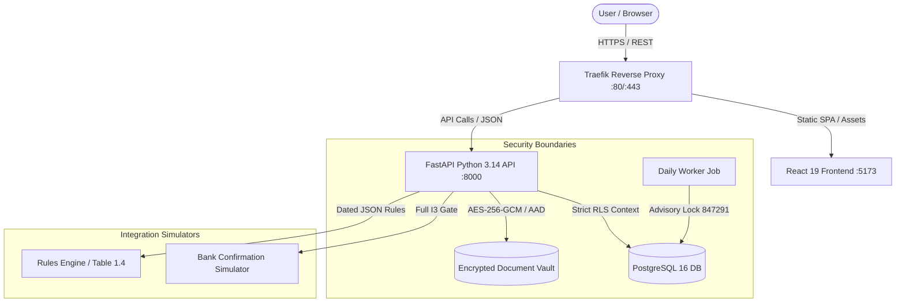

# Architecture, Data-Flow & Security/Privacy Summary — AICTE PS 26265

System design document detailing architectural layers, trust boundaries, cryptographic invariants, and privacy compliance.

---

## 1. Target Architecture Diagram

The following is a target deployment shape. The checked-in demo uses the local FastAPI, PostgreSQL and labelled simulator path; reverse proxy, worker and managed-hosting choices require an operations decision.

---

## 2. End-to-End Data Flow

1. **Authentication & RLS Context Ingestion:**
   - Client authenticates at `/api/v1/login/access-token` receiving 60-minute JWT.
   - On every request, `deps.py` calls `set_rls_context(session, role, institution_id, user_id)`.
   - PostgreSQL RLS enforces zero-row visibility if context is absent or malformed.
2. **Encrypted Vault Storage:**
   - Institution uploads FDR scan. Backend verifies magic bytes (`%PDF`, `\x89PNG`, etc.).
   - Document encrypted with AES-256-GCM using unique per-file IV and instrument ID as Additional Authenticated Data (AAD).
   - Cross-record decryption attempts fail cryptographically.
3. **Discrepancy Evaluation:**
    - Bank responses pass the full I3 gate report (`backend/app/domain/bank_gate.py`); simulated revocation is displayed as not checked.
   - Discrepancy engine evaluates D1 (Amount), D2 (Maturity), D3 (Ref), D4 (Bank), D5 (Lien), D6 (Duplicate).
   - Critical discrepancies block case release verification.
4. **Dual-Custody Release:**
   - Regional Officer verifies checklist (Maker).
   - Bureau Officer authorizes release (Checker).
   - Database constraint + API layer enforces `verified_by != approved_by`.
   - System issues RS256 signed release receipt verifiable offline without database access.
5. **Tamper-Evident Audit Ledger:**
   - State mutations invoke `audit_append()`.
   - Each event SHA-256 hash chains back to preceding event (`prev_hash`).
   - `SELECT audit_verify()` validates ledger continuity in real-time.

---

## 3. Security & Privacy Summary

### What is implemented in this prototype (not certified)
- **Integrity:** SHA-256 hash chained immutable audit ledger.
- **Confidentiality:** AES-GCM encrypted vault with magic byte verification.
- **Access Control:** Dual PostgreSQL roles (`migrator` vs `app` `NOSUPERUSER NOBYPASSRLS`).
- **Maker-Checker:** Dual-custody release model enforced cryptographically and relationally.
- **Data Minimization:** No personal phone numbers, live financial accounts, or unredacted tax IDs stored.
- **Formula Injection Defense:** `csv_safe` neutralizes spreadsheet macro exploits on export.

### What is NOT Certified (Prototype Limitations)
- This is a research prototype evaluating AICTE Problem Statement PS 26265 with synthetic test data.
- It has not received formal STQC / CERT-In third-party penetration certification.
- Live bank core-banking system adapters are simulators; a production rollout requires a bank-approved API or messaging agreement and regulator approval.
