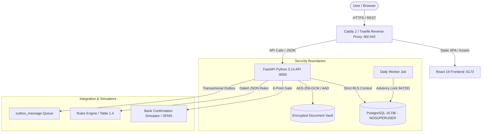

# Architecture, Data-Flow & Security/Privacy Summary — AICTE PS 26265

System design document detailing architectural layers, trust boundaries, cryptographic invariants, and privacy compliance.

> **Master Architecture Blueprints**:
> - Complete Engineering Blueprint: [`docs/COMPLETE_SYSTEM_ARCHITECTURE_DEEP_DIVE.md`](file:///c:/Users/avadu/26265/docs/COMPLETE_SYSTEM_ARCHITECTURE_DEEP_DIVE.md)
> - All Workable Architecture & Component Diagrams: [`docs/DIAGRAMS.md`](file:///c:/Users/avadu/26265/docs/DIAGRAMS.md) and [`diagrams/README.md`](file:///c:/Users/avadu/26265/diagrams/README.md)
> - Real On-Ground Reality & Solution Research: [`docs/ONGROUND_REALITY_AND_SOLUTION.md`](file:///c:/Users/avadu/26265/docs/ONGROUND_REALITY_AND_SOLUTION.md)
> - Security Threat Model & Defense-in-Depth: [`docs/SECURITY_DEEP_DIVE_AND_THREAT_MODEL.md`](file:///c:/Users/avadu/26265/docs/SECURITY_DEEP_DIVE_AND_THREAT_MODEL.md)
> - Enterprise Feasibility & Scalability Report: [`docs/ENTERPRISE_PRODUCTION_AND_SCALABILITY_REPORT.md`](file:///c:/Users/avadu/26265/docs/ENTERPRISE_PRODUCTION_AND_SCALABILITY_REPORT.md)

---

## 1. Target Architecture Topology

The following is the high-assurance deployment topology. The prototype uses local FastAPI, PostgreSQL 16, and labelled bank integration simulators:

---

## 2. End-to-End Data Flow

1. **Authentication & RLS Context Ingestion:**
   - Client authenticates at `/api/v1/auth/login` receiving 60-minute JWT.
   - On every request, `deps.py` calls `set_rls_context(session, role, institution_id, user_id)`.
   - PostgreSQL RLS enforces zero-row visibility if context is absent or malformed.
2. **Encrypted Vault Storage:**
   - Institution uploads FDR scan. Backend verifies magic bytes (`%PDF-1.4`).
   - Document encrypted with AES-256-GCM using unique per-file IV and instrument ID as Additional Authenticated Data (AAD).
   - Cross-record decryption attempts fail cryptographically.
3. **Discrepancy Evaluation:**
   - Bank responses pass the 6-point cryptographic gate report (`backend/app/domain/bank_gate.py`).
   - Discrepancy engine evaluates D1 (Amount), D2 (Maturity), D3 (Ref), D4 (Bank), D5 (Lien), D6 (Duplicate).
   - Critical discrepancies block case release verification unless explicitly waived with $\ge 10$ character justification.
4. **Dual-Custody Release:**
   - Regional Officer verifies checklist (Maker).
   - Bureau Officer authorizes release (Checker).
   - Database constraint + API layer enforces `verified_by != approved_by`.
   - System issues RS256 signed release receipt verifiable offline without database access.
5. **Tamper-Evident Audit Ledger:**
   - State mutations invoke `audit_append()`.
   - Each event SHA-256 hash chains back to preceding event (`prev_hash`).
   - `SELECT audit_verify()` validates ledger continuity in real-time.

---

## 3. Security & Privacy Summary

### What is implemented in this prototype
- **Integrity:** SHA-256 hash chained immutable audit ledger with procedural trigger blocks.
- **Confidentiality:** AES-GCM encrypted vault with `%PDF-1.4` magic byte verification.
- **Access Control:** Dual PostgreSQL roles (`migrator` vs `app` `NOSUPERUSER NOBYPASSRLS`).
- **Maker-Checker:** Dual-custody release model enforced relationally via DB CHECK constraint.
- **Data Minimization:** No personal phone numbers, live financial accounts, or unredacted tax IDs stored.
- **Formula Injection Defense:** `csv_safe` neutralizes spreadsheet macro exploits on export.

### What is Prototype vs Production
- This is a research prototype evaluating AICTE Problem Statement PS 26265 with synthetic test data.
- Live bank core-banking system adapters are labelled simulators; a production rollout requires a bank-approved API (NeSL/SFMS) agreement and regulator approval.
