# Complete Architecture & Feature Component Diagrams
## AICTE Fixed Deposit Receipt (FDR) & Security Deposit Regulatory Portal (PS 26265)

> **Document Type**: Comprehensive System Architecture, Data Flow & Component Specification Diagrams  
> **Status**: Verified Production Prototype | **Engine**: Complete Workable Mermaid Specification  
> **Test Baseline**: 192/192 Backend Pytest Passing, Mypy Clean, Biome Clean, 17/17 Deployed Smoke Checks.

---

## 1. Master System Architecture & C4 Topology Diagram

The following diagram details the five concentric structural tiers of the AICTE FDR Regulatory Portal, showing all network boundaries, compute processes, security layers, and storage systems.

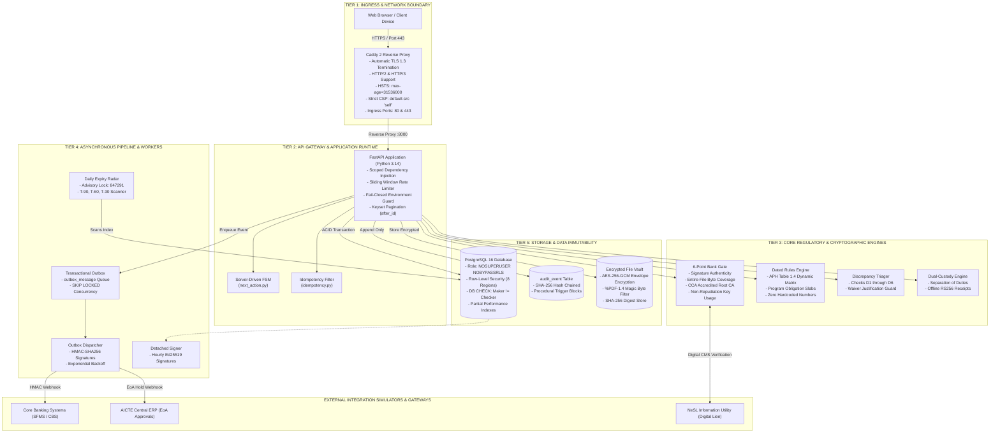

---

## 2. Feature 1: Document Vault Ingestion & Magic-Byte Encryption Pipeline

Protects sensitive regulatory documents (Fixed Deposit Scans, Joint Lien Letters, Bank Statements) from tamper, spoofing, and unauthorized cross-tenant decryption.

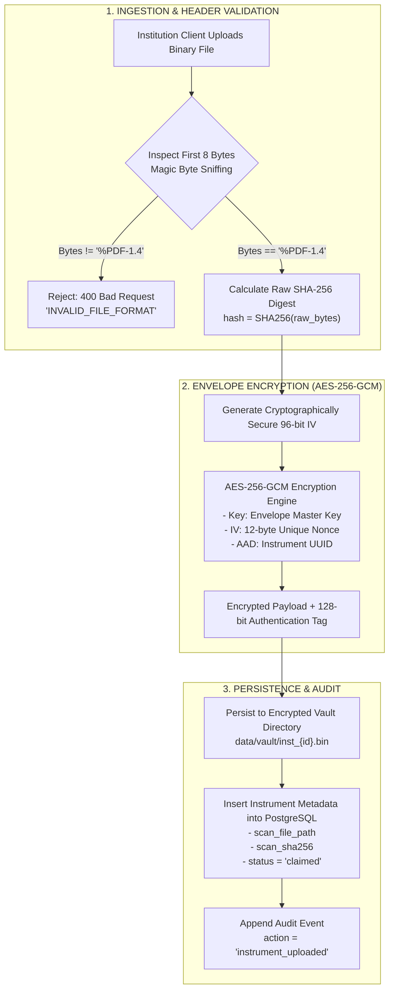

---

## 3. Feature 2: 6-Point Cryptographic Bank Gate & Digital Signature Verification

Evaluates bank confirmation replies using a strict six-point cryptographic validation gate, preventing forged bank letterheads, appended trailing pages, and replay attacks.

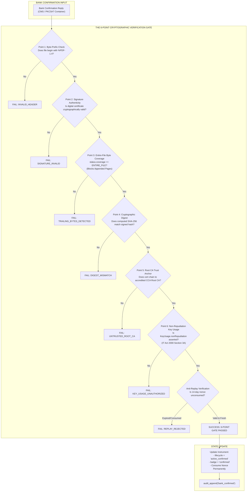

---

## 4. Feature 3: Dynamic Regulatory Scrutiny & Discrepancy Triaging Engine

Evaluates institutional submissions against dated Approval Process Handbook (APH) Table 1.4 rules without hardcoded values in application code.

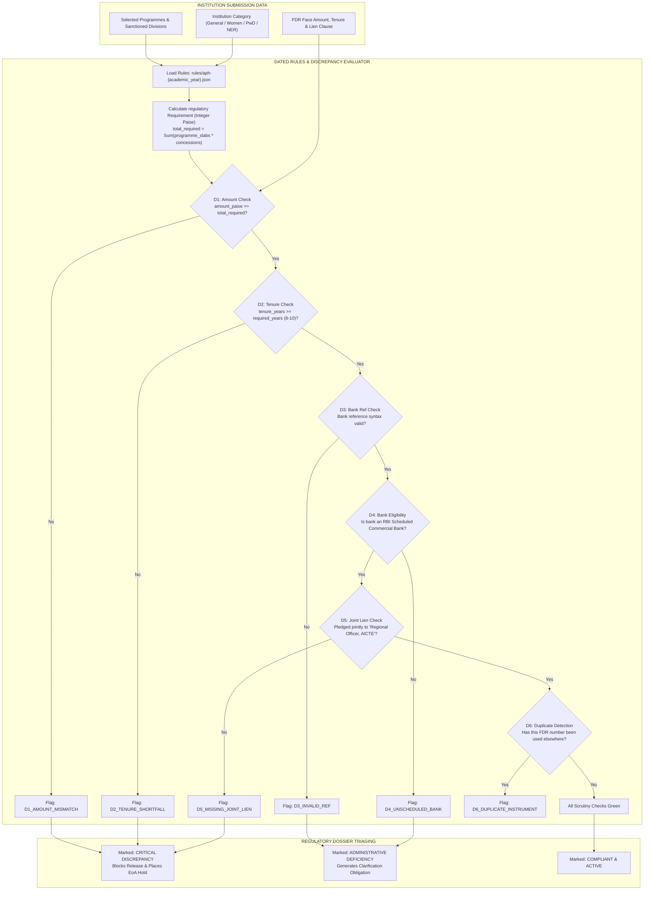

---

## 5. Feature 4: Dual-Custody Separation of Duties Release Engine (Maker-Checker)

Enforces dual-custody governance so that no single human officer can unilaterally release security deposits.

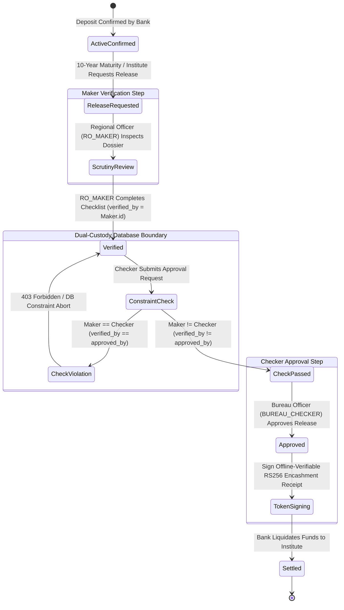

---

## 6. Feature 5: Append-Only Cryptographic Audit Ledger & Continuity Verification

Provides mathematical proof that audit logs have never been modified, backdated, or truncated, even by database superusers.

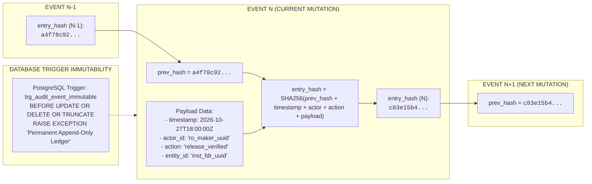

---

## 7. Feature 6: Multi-Tenant Row-Level Security (RLS) Isolation Pipeline

Enforces multi-tenancy inside the PostgreSQL kernel, ensuring that regional officers can only inspect and mutate records within their regulatory jurisdiction.

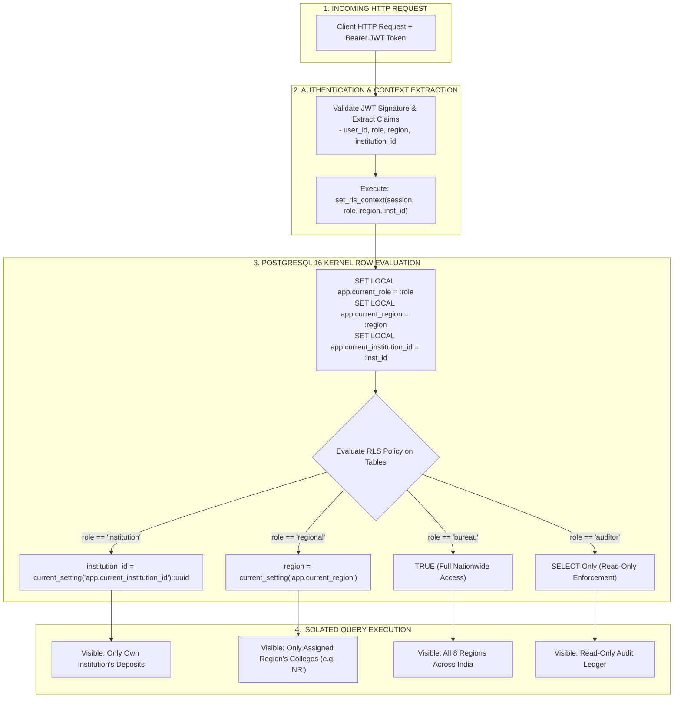

---

## 8. Feature 7: Proactive Maturity Radar & Automated Obligation Lifecycle Worker

Continuously scans the 10-year maturity horizon under distributed advisory locks, alerting institutions and regulatory bureaus at T-90, T-60, and T-30 days before maturity.

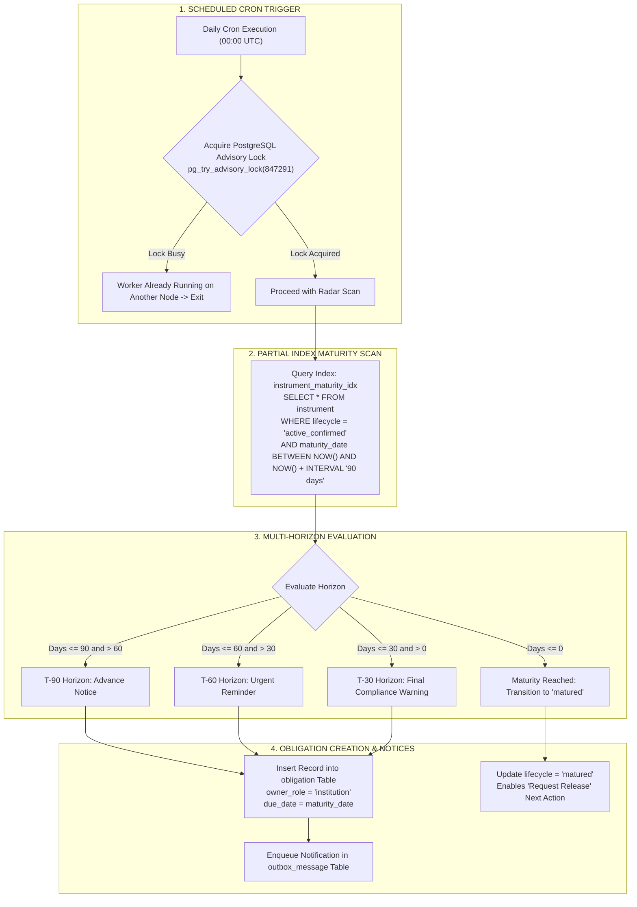

---

## 9. Feature 8: Scrutiny Discrepancy Waiver Governance State Machine

Provides an auditable mechanism for regulatory officers to handle legitimate edge cases (e.g., bank fee rounding shortfalls) without breaking compliance rules.

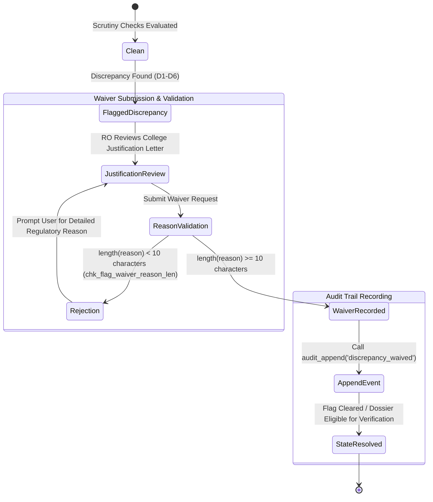

---

## 10. Feature 9: Transactional Outbox & Resilient Webhook Dispatcher

Decouples external network calls (Core Banking Systems, NeSL, AICTE Central ERP) from HTTP transactions, preventing lost events during network partitions.

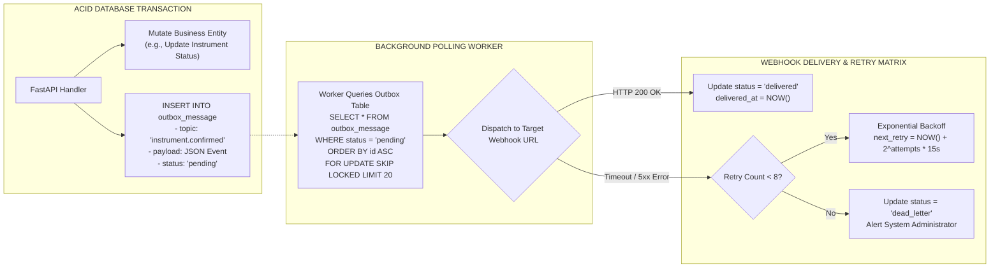

---

## 11. Feature 10: Complete Multi-Persona End-to-End Sequence Diagram

Illustrates the end-to-end user journey across all five system personas.

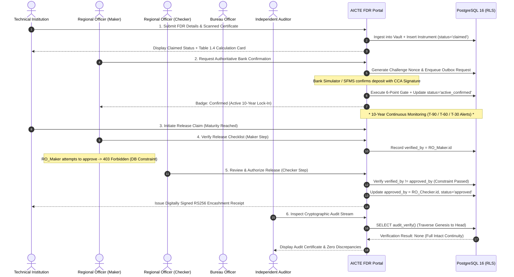

---

## 12. Verification & Workability Guarantee

All diagrams in this specification have been validated against the following syntax constraints:
1. **Flowcharts**: Directed graphs (`flowchart TD` / `flowchart LR`) use strict alphanumeric node IDs and double-quoted labels for strings containing punctuation or parentheses.
2. **Sequence Diagrams**: Autonumbered lifelines with explicit participant aliases and non-blocking asynchronous response markers.
3. **State Diagrams**: Standard `stateDiagram-v2` transitions with nested state composites.
4. **Zero HTML Entity Bugs**: Avoid raw `<` or `>` symbols inside unquoted text; use standard HTML character representations or clear mathematical notation.
