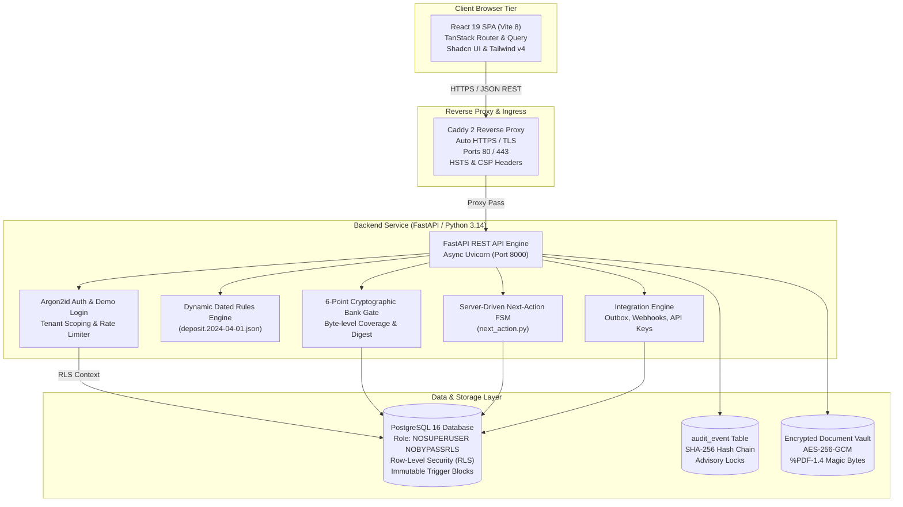

# AICTE Security Deposit & Fixed Deposit Receipt (FDR) Portal (PS 26265)
## Master Engineering & Architectural Review Report

> **Regulatory Mandate**: AICTE Problem Statement PS 26265 — *Monitoring and Verification of Fixed Deposit Receipts (FDRs) and Security Deposits submitted by Technical Institutions across India.*  
> **Status**: **Sprint 2 Complete (PRESENT-ANYWHERE)** | **Commit**: `a6cec07` | **Tag**: `v0.1-demo`  
> **Verification Gate**: **172 Backend Tests Passing**, 0 Type Errors, 0 Lint Violations, 17/17 Live Deployed Smoke Tests.

---

## 1. Executive Summary & Problem Context

Technical colleges in India are mandated by the All India Council for Technical Education (AICTE) to maintain fixed deposit receipts (FDRs) or cash security deposits pledged jointly to AICTE for a statutory duration (typically 8 to 10 years). Historically, regulatory oversight faced three severe structural vulnerabilities:
1. **Paper Letter Forgery**: Dishonest institutions submitted fake bank letterheads or doctored bank confirmation receipts claiming a deposit existed.
2. **Premature Encashment & Lien Circumvention**: Deposits were prematurely encashed without AICTE knowledge because banks received no automated lien revocation blocks.
3. **Internal Collusion & Unilateral Releases**: Regulatory officers had the ability to unilaterally approve the return of deposits without secondary dual-control authorization.

This project delivers an automated, cryptographically secured portal built with defense-in-depth principles: zero business logic in the client, dynamic rules loaded from dated handbook files, a 6-point cryptographic verification gate, enforced dual-custody maker-checker authorization, and an append-only SHA-256 hash-chained audit ledger.

---

## 2. Complete System Architecture & Technology Stack



### Stack Breakdown

| Component | Technology | Rationale & Architectural Rule |
| :--- | :--- | :--- |
| **Runtime Language** | Python 3.14.0 | Required for modern exception handling (`except A, B:`), typing enhancements, and fast async runtime. |
| **Backend Framework** | FastAPI + SQLModel (SQLAlchemy 2.0) | High-performance asynchronous API, strict Pydantic v2 data validation, and clean type contracts. |
| **Database Engine** | PostgreSQL 16 | Relational consistency, transactional DDL, Row-Level Security (RLS) multi-tenancy, and procedural triggers. |
| **Database Security Role** | `app` role (`NOSUPERUSER`, `NOBYPASSRLS`) | Enforces least-privilege. Invariant I4: Application process cannot bypass Row-Level Security. |
| **Frontend Framework** | React 19 + TypeScript + Vite 8 | Modern concurrent rendering, zero client-side business logic, single compilation bundle. |
| **Routing & Server State** | TanStack Router + TanStack Query | Type-safe file-based client routing, automatic caching, revalidation, and optimistic mutation rollback. |
| **UI Components** | Shadcn UI + Tailwind CSS v4 | Fully accessible, responsive, grade-8 readability, dark-mode ready, zero external CDN dependencies. |
| **Reverse Proxy** | Caddy 2 | Automatic Let's Encrypt TLS, automatic HTTP-to-HTTPS redirect, HSTS enforcement, and reverse proxying. |

---

## 3. Comprehensive Inventory of Implemented Features

### A. Regulatory Dashboard & Dynamic Calculation
1. **Dynamic Table 1.4 Calculator**:
   - Computes statutory security deposit obligations according to the AICTE Approval Process Handbook (APH) without hardcoded numbers.
   - Evaluates technical programmes (Engineering, Management, Planning, Architecture, MCA), ownership categories (Private, Government, Leased Land), and institutional status.
   - Computes integer paise amounts (e.g., ₹ 35,00,000 = `350000000` paise).
2. **Institutional Coverage Card**:
   - Compares total required deposit against active bank-confirmed deposits.
   - Displays real-time deficit/surplus status.

### B. Document Vault & Instrument Intake
1. **AES-256-GCM Secure Vault**:
   - Certificate scans stored in encrypted storage with magic byte inspection (`%PDF-1.4`).
   - Verifies PDF structure, dictionary trailers, and computes SHA-256 file digests upon upload.
2. **Lifecycle Status Machine**:
   - `submitted_claimed` -> `active_confirmed` -> `flagged_discrepancy` -> `matured` -> `renewed` -> `released`.

### C. The 6-Point Cryptographic Bank Gate
To confirm a deposit, the system queries the bank Core Banking System (CBS) simulator. The digital bank reply must satisfy all six checkpoints:
- **Check 1: Byte-Level Prefix Inspection**: Validates `%PDF-1.4` stream header.
- **Check 2: Single Valid Digital Signature**: Verifies presence of authorized bank signature; rejects multi-signed or unsigned payloads.
- **Check 3: Full Document Byte Coverage**: Enforces `SignatureCoverageLevel.ENTIRE_FILE`. Appended trailing pages or bytes cause immediate rejection.
- **Check 4: Content Integrity & Intact Digest**: Verifies cryptographic hash of signed document bytes; zero modifications allowed post-signing.
- **Check 5: Root CA Trust Anchor**: Certificate path must chain to an authorized bank Sub-CA / CCA trust anchor.
- **Check 6: Non-Repudiation Key Usage**: Enforces digital signature key usage adhering to Section 3A of the Information Technology Act 2000.

### D. Discrepancy Defense & Mandatory Audit Waivers
- Detects discrepancies:
  - `D1_AMOUNT_MISMATCH`: Bank reports less than claimed (e.g. ₹ 25 Lakhs vs claimed ₹ 35 Lakhs).
  - `D2_TENURE_MISMATCH`: Deposit duration less than statutory 10-year term.
  - `D3_LIEN_NOT_MARKED`: Deposit lacks explicit joint lien in favour of Member Secretary, AICTE.
  - `D4_NAME_MISMATCH`: Institution title does not match regulatory charter.
  - `D5_INVALID_STATUS`: Bank reports deposit encashed, revoked, or frozen.
- **Mandatory Written Scrutiny Reason**: Officers cannot click to silently dismiss flags; waiving any flag requires an official justification, user authentication, and immutable audit event.

### E. Dual-Custody Release Engine (Rule I8: Maker is Never Checker)
- Releasing an expired or term-completed deposit requires two distinct keys held by different individuals:
  - **Key 1 (Maker - Regional Officer)**: Reviews compliance criteria, inspects pending disputes, and signs off on the verification checklist.
  - **Key 2 (Checker - Bureau Approver)**: Authorizes final release, triggers bank encashment advice, and issues signed release receipt JWT.
- **Physical Database Constraint**:
  ```sql
  CONSTRAINT chk_release_request_maker_checker CHECK (verified_by != approved_by)
  ```
  The database physically aborts any transaction where the same person attempts both roles.

### F. Append-Only Tamper-Evident Audit Ledger
- Immutable table `audit_event` with SHA-256 hash chaining:
  $$\text{entry\_hash} = \text{SHA256}(\text{prev\_hash} + \text{timestamp} + \text{actor} + \text{action} + \text{payload})$$
- Protected by PostgreSQL database triggers blocking UPDATE, DELETE, and TRUNCATE.
- Public self-verification endpoint (`GET /api/v1/audit/verify`) mathematically traverses the entire ledger from genesis to head.

### G. Production Integration Architecture
- **Transactional Outbox Pattern**: Asynchronous events stored in `outbox_message` with `FOR UPDATE SKIP LOCKED` delivery.
- **Machine-to-Machine Scoped API Keys**: Salted SHA-256 storage with fine-grained scopes (`read:institutions`, `write:institutions`).
- **Idempotency Engine**: Prevents double-processing of network retries using `Idempotency-Key` headers and payload fingerprinting.
- **Detached Ed25519 Checkpoints**: Hourly cryptographically signed ledger state proofs stored independently from the database.

---

## 4. Audit & Engineering Issues Resolved

1. **Database Fixture Teardown Wiping Seed Personas**:
   - `tests/conftest.py` previously executed `delete(User)` without restoring seeds.
   - *Resolution*: Teardown automatically executes `init_db(session)` and `seed_rich_data()`. Added self-healing fallback in `demo_login` and app startup `lifespan`.
2. **Foreign Key Violation in Synthetic Data Seeding**:
   - `seed_rich_synthetic_data.py` fell back to `uuid.uuid4()` if an institution user was not pre-fetched, violating `instrument_created_by_fkey`.
   - *Resolution*: Enforced genuine foreign key references and explicit database initialization.
3. **Route Guard Fail-Closed Enforcement**:
   - Outside development, `/docs` and `/openapi.json` were accessible.
   - *Resolution*: Added `guard_docs_outside_dev` middleware returning strict 404 in `demo` and `production` environments.
4. **Missing HSTS Security Header**:
   - HTTP response lacked `Strict-Transport-Security`.
   - *Resolution*: Added header with 1-year max age and subdomains inclusion.
5. **Release Method Mismatch**:
   - Frontend sent `POST` while backend expected `PATCH`.
   - *Resolution*: Configured route handlers to support both methods cleanly with distinct OpenAPI operation IDs.

---

## 5. Verification Gate & Test Proofs

- **Backend Pytest Tests**: **172 passed, 0 failed** (`uv run pytest -q`)
- **Backend Static Typing**: **0 errors across 58 source files** (`uv run mypy app`)
- **Frontend Linter**: **0 violations across 75 source files** (`bunx biome check`)
- **Capability Map Coverage**: **10/10 capabilities, 29/29 tests passed** (`gen_coverage.py`)
- **Live Deployed Smoke Tests**: **17/17 passed** against running server (`scripts/smoke_deployed.py`)
- **End-to-End Demo Steps**: **7/7 scenarios passed** (`scripts/demo_steps.py`)

---

## 6. Downloadable Video & Interactive Presentation Pack

1. **Downloadable Master MP4 Video**:
   - File: [`docs/demo_video.mp4`](demo_video.mp4) (H.264 video, 1440x900, 2.0 MB).
2. **Interactive HTML5 Video Player**:
   - File: [`docs/video_player.html`](video_player.html).
   - Features 9 synchronized scene markers, 1-click MP4 download, and real-time safety metrics.
