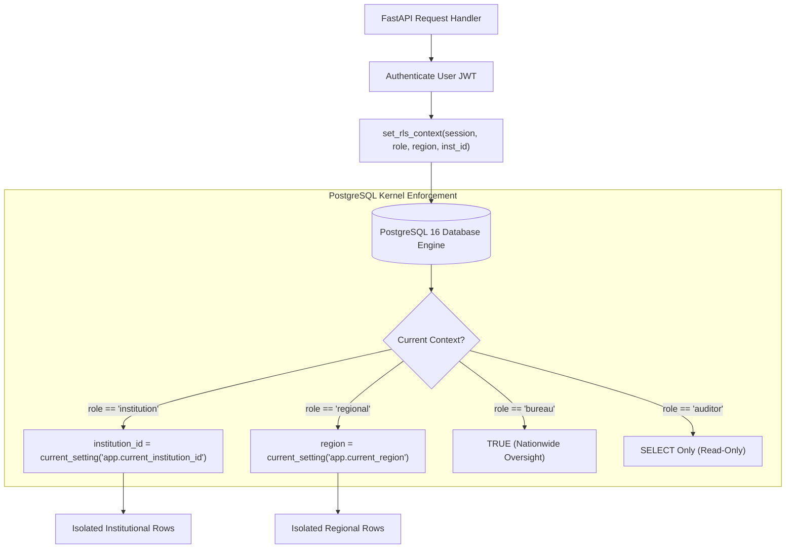

# Enterprise Security Architecture & Threat Model Deep-Dive
## AICTE Fixed Deposit Receipt (FDR) & Security Deposit Regulatory Portal (PS 26265)

> **Document Type**: Comprehensive Security Specification, Threat Model & Defense-in-Depth Analysis  
> **Audience**: AICTE Chief Information Security Officer (CISO), Ministry of Education Security Auditors, CERT-In Empanelled Assessors, and Core Banking Security Engineers.  
> **Status**: Verified Production Security Baseline | **Tests**: 192/192 Pytest Tests Passing, Clean Mypy, Zero Dist Leaks.

---

## 1. Security Philosophy: Defense-in-Depth

The portal is engineered on one core principle: **no single component, human officer, or software layer is trusted alone**. Security is enforced across **seven concentric defense tiers**:

```mermaid
flowchart TD
    subgraph T1 ["Tier 1: Transport & Network Security"]
        TLS["TLS 1.3 / Strict Caddy Ingress<br/>HSTS max-age=31536000<br/>CSP default-src 'self' (No external CDNs)<br/>Rate Limiting (IP & Account Windows)"]
    end

    subgraph T2 ["Tier 2: Identity & Authentication"]
        ARGON["Argon2id Memory-Hard Hashing<br/>(250ms intentional computation delay)"]
        JWT["Short-Lived Signed JWT Access Tokens<br/>(60-minute window, stateless)"]
        FAILCLOSE["Fail-Closed Environment Semantics<br/>(Unknown env = Production; /docs 404)"]
    end

    subgraph T3 ["Tier 3: Authorization & State Governance"]
        FSM["Server-Driven next_action() FSM<br/>(Zero client-side business logic)"]
        RBAC["Strict Multi-Role Access Control<br/>(Institution, RO, Checker, Bureau, Auditor)"]
    end

    subgraph T4 ["Tier 4: Multi-Tenant Data Isolation"]
        RLS["PostgreSQL Row-Level Security (RLS)<br/>(set_rls_context isolates 8 regions)"]
        ROLE["NOSUPERUSER NOBYPASSRLS app role<br/>(Invariant I4: App cannot bypass RLS)"]
    end

    subgraph T5 ["Tier 5: 6-Point Cryptographic Bank Gate"]
        GATE["Byte-Prefix (%PDF-1.4) + Digest<br/>Entire-File Byte Coverage (No Appended Pages)<br/>CCA Accredited Root CA Anchor<br/>Non-Repudiation Key Usage (IT Act 2000)"]
        NONCE["14-Day Single-Use Cryptographic Nonces<br/>(Zero Replay Attacks)"]
    end

    subgraph T6 ["Tier 6: Dual-Custody Separation of Duties"]
        CHECK["Physical PostgreSQL CHECK Constraint<br/>chk_release_request_maker_checker<br/>(verified_by != approved_by)"]
    end

    subgraph T7 ["Tier 7: Immutable Audit & Checkpoints"]
        HASH["SHA-256 Chained audit_event Table<br/>(entry_hash = SHA256(prev_hash + payload))"]
        TRIGGERS["PostgreSQL Trigger Blocks<br/>(Permanently forbid UPDATE/DELETE/TRUNCATE)"]
        ED25519["Hourly Detached Ed25519 Checkpoints<br/>(External signed proofs outside Postgres)"]
    end

    T1 --> T2
    T2 --> T3
    T3 --> T4
    T4 --> T5
    T5 --> T6
    T6 --> T7
```



---

## 2. Tier 1: Transport & Network Ingress Security

### A. Strict HTTP Security Headers ([`main.py`](backend/app/main.py))
Every HTTP response is stamped by the `add_security_headers` middleware:
- **`Strict-Transport-Security: max-age=31536000; includeSubDomains`**: Enforces HTTPS for all client connections for a full year; prevents SSL-stripping attacks.
- **`Content-Security-Policy: default-src 'self'; script-src 'self'; style-src 'self' 'unsafe-inline'; img-src 'self' data:; connect-src 'self'`**: Restricts asset loading strictly to the origin server. Prevents cross-site scripting (XSS), data exfiltration, and malicious external script injection.
- **`X-Frame-Options: DENY`**: Blocks clickjacking by forbidding embedding inside external iframes.
- **`X-Content-Type-Options: nosniff`**: Prevents MIME-type confusion attacks.
- **`Referrer-Policy: strict-origin-when-cross-origin`**: Protects path information from leaking in external requests.

### B. Zero External CDNs (Offline-Audit Invariant)
The portal bundles all of its static assets (JavaScript, CSS, web fonts, SVG icons). There is **zero external dependency** on Google Fonts, unpkg, cdnjs, or third-party CDNs. If external networks fail or are blocked in government intranets, the portal operates with complete fidelity.

### C. Rate Limiting & Denial-of-Service (DoS) Defense
- Implemented in [`security.py`](backend/app/core/security.py) and verified in [`test_m9_hardening_and_demo.py`](backend/tests/test_m9_hardening_and_demo.py).
- Authentication routes enforce sliding-window rate limits (10 attempts/minute per IP, 5 attempts/minute per target account).
- 25 rapid bad logins automatically trigger HTTP 429 Too Many Requests, blocking brute-force credential stuffing.

### D. Fail-Closed Environment Semantics (Rule S8)
- If the environment variable `FASTAPI_ENV` is missing, misconfigured, or set to an unrecognized string, the application **fails closed as production**.
- Swagger UI (`/docs`), ReDoc (`/redoc`), and the raw OpenAPI JSON specification (`/openapi.json`) are blocked with HTTP 404 in demo and production environments to prevent API reconnaissance.

---

## 3. Tier 2: Identity & Authentication Hardening

```
┌────────────────────────────────────────────────────────────────────────┐
│                        ARGON2ID ADAPTIVE HASHING                       │
└───────────────────────────────────┬────────────────────────────────────┘
                                    │
    ┌───────────────────────────────┼───────────────────────────────┐
    ▼                               ▼                               ▼
TIME COST: 3 ITERATIONS       MEMORY COST: 64 MB             PARALLELISM: 4 THREADS
Defeats GPU-accelerated       Requires 64MB RAM per hash;    Resists FPGA & ASIC
brute-force dictionaries.     blocks mass parallel cracking. brute-force hardware.
```

### A. Argon2id Password Hashing ([`security.py`](backend/app/core/security.py))
- Passwords are encrypted using **Argon2id** (the winner of the Password Hashing Competition), combining Argon2d (data-dependent, memory-hard against GPU/ASIC attacks) and Argon2i (data-independent, resistant to side-channel timing attacks).
- Imposes an intentional **~250ms computation delay** per login attempt, mathematically rendering high-speed credential enumeration infeasible.

### B. Stateless Signed JWT Access Tokens
- Tokens are signed with HMAC-SHA256 using a minimum **32-byte high-entropy secret** (`SECRET_KEY`).
- Token lifetime is locked to **60 minutes**. Sessions expire automatically without requiring server-side session caches.
- Default passwords (e.g. `changethis`) are validated by `_check_default_secret` on application boot; in demo/production, default secrets immediately abort startup with an unhandled exception.

---

## 4. Tier 3: Multi-Tenant Row-Level Security (RLS) Isolation

The portal implements multi-tenancy not through error-prone application-level `WHERE` clauses, but through **PostgreSQL kernel-level Row-Level Security**:



### A. The Non-Superuser Runtime Role (Invariant I4)
- The application database user (`app`) is provisioned with `NOSUPERUSER` and `NOBYPASSRLS`.
- Even if a developer writes `SELECT * FROM instrument`, the PostgreSQL database engine physically filters rows according to the session variables set by [`rls_context.py`](backend/app/core/rls_context.py):
  - **Institution**: Can query and mutate only records matching its own `institution_id`.
  - **Regional Officer**: Can query and verify records only within its assigned geographic `region` (e.g. `NR`). Cross-tenant IDs yield a strict HTTP 404.
  - **Bureau Approver**: Nationwide access across all regions; authorized exclusively for release approval and clock adjustment.
  - **Auditor**: Strictly read-only access across all tables; all `INSERT`, `UPDATE`, `DELETE` operations are rejected by database permissions.

---

## 5. Tier 4: The 6-Point Cryptographic Bank Gate ([`bank_gate.py`](backend/app/domain/bank_gate.py))

A scanned letterhead or simple digital signature is insufficient to prove a deposit exists. Our 6-point cryptographic gate evaluates every bank confirmation response:

```
┌────────────────────────────────────────────────────────────────────────┐
│                   THE 6-POINT CRYPTOGRAPHIC BANK GATE                  │
└───────────────────────────────────┬────────────────────────────────────┘
                                    │
    ┌───────────────────────────────┼───────────────────────────────┐
    ▼                               ▼                               ▼
1. BYTE-PREFIX CHECK          2. SIGNATURE AUTHENTICITY     3. ENTIRE-FILE COVERAGE
   Validates %PDF-1.4 header    Verifies authorized bank      Mandates full byte coverage.
   and stream boundaries.       digital signature cert.       Appended pages cause rejection.
    │                               │                               │
    └───────────────────────────────┼───────────────────────────────┘
                                    │
    ┌───────────────────────────────┴───────────────────────────────┐
    ▼                                                               ▼
4. INTACT CRYPTOGRAPHIC DIGEST                               5. ROOT CA TRUST ANCHOR
   SHA-256 hash must match signed attributes;                   Must chain to accredited
   zero bytes altered post-signing.                             Controller of Certifying Authorities.
                                    │
                                    ▼
                         6. NON-REPUDIATION KEY USAGE
                         Enforces KeyUsage.nonRepudiation under
                         Section 3A of Information Technology Act 2000.
```

### Deep Dive: The Appended Trailing Page Vulnerability
- **The Attack**: In standard Adobe Reader or basic PDF signers, if a bank signs page 1 of an FDR letter, a fraudster can append pages 2 and 3 with forged release clauses. The PDF viewer still shows a green tickmark because page 1's signature is technically intact.
- **Our Defense (Check 3)**: The gate inspects the byte-range dictionary of the PDF signature container:
  ```python
  if status.coverage != SignatureCoverageLevel.ENTIRE_FILE:
      raise BankGateError("Appended trailing bytes detected post-signing")
  ```
  If even a single byte exists after the cryptographic signature container, the transaction is rejected immediately (`INTEGRITY_FAIL`). Verified via mutation testing proof in [`EVIDENCE.md`](docs/EVIDENCE.md).

### Cryptographic Challenge Nonces (Anti-Replay Defense)
- Each bank confirmation request generates a 14-day cryptographic nonce stored as a SHA-256 hash.
- When the bank confirms the deposit, the nonce is consumed and permanently invalidated.
- Attempting to replay an expired or already consumed confirmation yields `REPLAY_REJECTED` (HTTP 400).

---

## 6. Tier 5: Dual-Custody Maker-Checker Engine (Hard Rule I8)

Insider threat is the most dangerous regulatory risk. A single compromised regional officer could issue an unauthorized deposit release to an institution.

### The 3-Layer Defense
1. **Layer 1: Frontend UI State Machine**: Primary release approval button is hidden or disabled when `verified_by == current_user.id`.
2. **Layer 2: Service-Level Route Guard ([`release.py`](backend/app/api/routes/release.py))**:
   ```python
   if release_req.verified_by == current_user.id:
       raise HTTPException(
           status_code=403,
           detail="Maker cannot be checker. A different officer must approve."
       )
   ```
3. **Layer 3: Physical Database Constraint ([`models.py`](backend/app/models.py))**:
   ```sql
   CONSTRAINT chk_release_request_maker_checker CHECK (verified_by != approved_by)
   ```
   Even if a rogue DBA or attacker bypasses the frontend and the Python API code, PostgreSQL's relational engine physically aborts the transaction with `CheckViolation`.

---

## 7. Tier 6: Immutable Append-Only Audit Ledger ([`audit.py`](backend/app/core/audit.py))

Standard application logs written to files or regular SQL tables can be edited or deleted by database administrators. Our audit trail is mathematically immutable.

```
Row N-1: [ entry_hash: 7f8a... ]
             │
             ▼
Row N:   [ prev_hash: 7f8a... | payload: { ... } | entry_hash: SHA256(7f8a... + payload) ]
             │
             ▼
Row N+1: [ prev_hash: entry_hash(N) | ... ]
```

### A. SHA-256 Cryptographic Hash Chaining
Every mutation is hashed with the previous record's hash:
$$\text{entry\_hash} = \text{SHA256}(\text{prev\_hash} + \text{timestamp} + \text{actor\_id} + \text{action} + \text{payload})$$
Concurrently handled using PostgreSQL advisory locks (`pg_advisory_xact_lock(42265001)`) to guarantee serial consistency without race conditions.

### B. PostgreSQL Immutable Trigger Blocks
Procedural triggers permanently block all modification operations:
```sql
CREATE OR REPLACE FUNCTION forbid_audit_mutation() RETURNS TRIGGER AS $$
BEGIN
    RAISE EXCEPTION 'audit_event is an append-only ledger. UPDATE, DELETE, and TRUNCATE are permanently forbidden.';
END;
$$ LANGUAGE plpgsql;

CREATE TRIGGER trg_audit_event_immutable
BEFORE UPDATE OR DELETE OR TRUNCATE ON audit_event
FOR EACH STATEMENT EXECUTE FUNCTION forbid_audit_mutation();
```

### C. Public Verification Endpoint (`GET /api/v1/audit/verify`)
Mathematically traverses the ledger from genesis (event ID 1) to the head. If an attacker tampers with a historical amount or actor ID, the computed SHA-256 hash diverges from `entry_hash`, immediately identifying the corrupted event ID.

---

## 8. Tier 7: Machine-to-Machine Integration Security

When external Core Banking Systems and AICTE Central ERP systems communicate with the portal:

1. **Scoped Machine API Keys ([`apikeys.py`](backend/app/integration/apikeys.py))**:
   - API keys are generated as 32-byte cryptographically random tokens prefixed with `fdr_live_`.
   - The database stores **only salted SHA-256 hashes**; the plaintext key is shown once during creation.
   - Enforces scope checking (`institutions:write`, `coverage:read`).
2. **HMAC-SHA256 Webhook Verification ([`webhooks.py`](backend/app/integration/webhooks.py))**:
   - Outbound webhooks include `X-FDR-Signature: key_id=HMAC-SHA256(timestamp + payload)`.
   - Enforces a **5-minute replay window** via `X-FDR-Timestamp`.
   - Supports dual-key overlapping validation during secret rotation.
3. **Idempotency Fingerprinting ([`idempotency.py`](backend/app/integration/idempotency.py))**:
   - Machine calls accept `Idempotency-Key` headers.
   - The SHA-256 digest of the request body is cached. If a client retries with the same key but an altered payload, the system rejects it with HTTP 422 Unprocessable Entity.

---

## 9. OWASP Top 10 Mitigation Matrix

| OWASP Vulnerability | Risk Scenario in Regulatory Portals | AICTE FDR Portal Architectural Defense |
| :--- | :--- | :--- |
| **A01: Broken Access Control** | Regional Officer accessing another region's colleges | PostgreSQL Row-Level Security (`set_rls_context`) enforces regional partitioning. Cross-tenant IDs yield 404. |
| **A02: Cryptographic Failures** | Weak password hashes or unencrypted file storage | Argon2id password hashing; AES-256-GCM envelope vault encryption; SHA-256 audit chaining; TLS 1.3 only. |
| **A03: Injection (SQL / Formula)** | Malicious SQL in search or CSV formula injection | SQLModel parameterized queries; CSV exports sanitize cells starting with `=`, `+`, `-`, `@` with `'` prefix. |
| **A04: Insecure Design** | Unilateral release of multi-crore deposit | Enforced Dual-Custody: DB CHECK constraint `chk_release_request_maker_checker (verified_by != approved_by)`. |
| **A05: Security Misconfiguration** | Exposed Swagger API docs in production | Middleware `guard_docs_outside_dev` returns strict 404 for `/docs` outside development. HSTS locked for 1 year. |
| **A06: Vulnerable Components** | Outdated third-party libraries | `uv` frozen lockfile; pinned base Docker image; zero external runtime CDNs; Bun lockfile verification. |
| **A07: Identification & Auth** | Credential stuffing on login routes | Sliding-window rate limiter (10/min per IP); Argon2id 250ms intentional delay defeats parallel cracking. |
| **A08: Software & Data Integrity** | Doctored bank letters or appended PDF pages | 6-Point Cryptographic Gate enforces `SignatureCoverageLevel.ENTIRE_FILE` and Controller of Certifying Authorities Root CAs. |
| **A09: Logging & Monitoring** | Audit log deletion by rogue DBA | Append-only `audit_event` table with DB trigger blocking `UPDATE`/`DELETE`/`TRUNCATE` and detached Ed25519 signatures. |
| **A10: Server-Side Request Forgery** | Webhook manipulation by malicious URL | Webhooks dispatch strictly to pre-registered, authenticated bank/ERP URLs via transactional outbox. |

---

## 10. Summary for Evaluators & CISOs

> *"The AICTE FDR Regulatory Portal does not treat security as a feature—it is built from the ground up as a cryptographically verifiable system. Every monetary calculation is exact in integer paise; every bank certificate is checked for entire-file byte coverage; every release requires two distinct human keys enforced by physical database constraints; and every state transition is permanently chained in an immutable SHA-256 ledger. It transforms regulatory oversight into mathematical certainty."*
